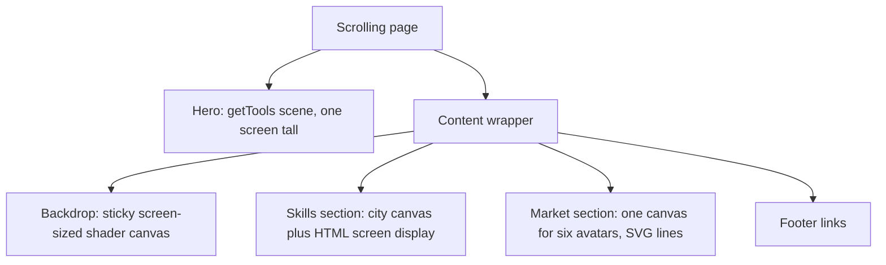

# Several 3D Canvases on One Page

The homepage is an ordinary scrolling web page that happens to hold four WebGL canvases: the hero
scene with the sleeping logo, the skills city, the six market avatars, and the dotted map behind
them all. This guide explains how they are split, which parts of the toolkit each one uses, and
the traps that only show up once several canvases share a page.

> **Source files:** `src/views/Experiments/LandingPage/LandingPage.vue`,
> `src/views/Experiments/LandingPage/SkillsCity.vue`, `src/views/Experiments/LandingPage/cityStage.ts`,
> `src/views/Experiments/LandingPage/MarketSectors.vue`, `src/views/Experiments/LandingPage/avatarStage.ts`,
> `src/views/Experiments/LandingPage/ContourBackdrop.vue`, `src/views/Experiments/LandingPage/backdropShader.ts`

## Why not one canvas

A full-screen 3D view in this project is one canvas that owns the whole window, set up by
`getTools` from `@webgamekit/threejs`. That fits the hero: it is exactly one screen tall and has
physics, an animation loop and the debug panels. Everything below it is page content, with text,
links and a layout that reflows on a phone. Drawing that content into the hero's canvas would mean
either a canvas as tall as the whole page or re-implementing the page layout in 3D. Instead, each
piece of 3D sits in the page where it belongs, on its own canvas, and the browser does the layout.

## The four canvases

| Canvas   | Built with                                                 | Draws                                          | Sized by                         |
| -------- | ---------------------------------------------------------- | ---------------------------------------------- | -------------------------------- |
| Hero     | `getTools`, `getModel`, `getPhysic`                        | every frame, in the toolkit's loop             | the window                       |
| City     | its own renderer; the model through `loadGLTF`             | every frame while on screen                    | a `ResizeObserver` on the canvas |
| Avatars  | its own renderer; the model through `loadGLTF`             | once per resize, since the avatars stand still | a `ResizeObserver` on the canvas |
| Backdrop | its own renderer; a `ShaderMaterial` on a full-screen quad | every frame while its content is on screen     | the screen, by sticking in place |

The city and the avatars do not need `getTools`: they have no physics, no controls and no debug
panels, so a renderer, a scene and a camera are all they take. What they do share with the rest of
the toolkit is asset loading. `loadGLTF` caches each model by its URL, and each component calls
`assetsRelease` with that URL when it unmounts, so leaving the page frees the geometry, and coming
back reuses the cache instead of downloading again. The city and the avatars are also lit by the
same function, so the two read as one world.

Each canvas caps its own pixel ratio. The backdrop is the cheapest to soften and is held lowest,
because it is the largest and the least looked at.

## Drawing only when it matters

Four render loops running at once would spend most of their time drawing things nobody can see.
Each canvas therefore decides when to draw:

- The city animates only while an `IntersectionObserver` reports it on screen. Off screen it draws
  just enough to finish a hover lift and to stay correct after a resize.
- The avatars stand still, so they are drawn when the section changes size and never otherwise.
- The backdrop animates while its content is on screen, and with reduced motion requested its time
  stands still so it only follows the scroll.

## One canvas for six avatars

Every canvas is its own WebGL context, with its own copy of every shader and buffer, and browsers
cap how many a page may hold, dropping the oldest when that is exceeded. Six more contexts for six
small models would cost far more than the models themselves. The six avatars share one canvas instead: it covers the whole section, and each
model is drawn with its own camera into the square over its slot, using the renderer's viewport and
scissor, before the next one. The slots are measured from the page each time, so the models follow
the layout from one row on a desktop to two staggered rows on a phone.

## The backdrop that is only one screen tall

The map behind the content looks as if it covers the whole page, but its canvas is exactly one
screen tall. It is the first child of the content wrapper and sticks to the top of the screen while
the content scrolls past, and a negative bottom margin of its own height means it takes up no room.
Each frame, the shader is told how far the content's top has gone above the screen and shifts the
map by that much, so the dots appear to scroll with the page. A long page costs no more than one
screen.

## Traps

| Symptom                                                    | Cause                                                                                                                                     |
| ---------------------------------------------------------- | ----------------------------------------------------------------------------------------------------------------------------------------- |
| A canvas floats over the next section, or fills the window | `App.vue` positions every canvas absolutely for full-screen views; a canvas in the page flow has to set its own position                  |
| Text or links vanish behind the backdrop                   | a sticky canvas counts as positioned and paints over any later sibling that is not; the footer and the phone hint are positioned for that |
| The models disappear behind their own slots                | the avatar canvas has to come after the list in the page so it paints over it                                                             |
| The avatar canvas turns solid black                        | three.js sets its clear colour only inside `render()`, so a manual clear before the first render clears to opaque black                   |
| The shader colours come out darker than the colours given  | a `ShaderMaterial` receives colours in linear space and has to convert its output back for the screen                                     |
| The screen display drifts off its sign                     | the display is placed as a share of the city's frame, so anything added inside that frame moves it; extra content goes outside it         |

The reasoning behind each piece, and the attempts that did not work, are in
[the homepage journey](../journey/homepage-sleeping-logo-and-skills-city.md).
