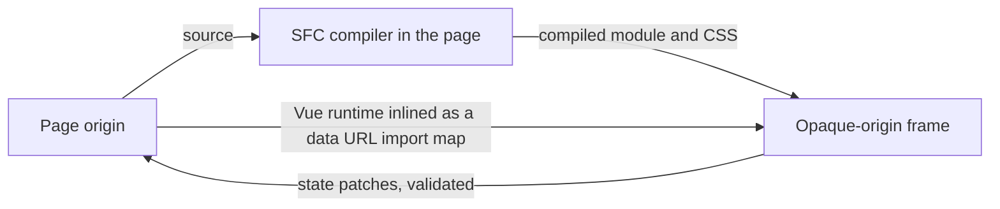

# Generative Canvas: Hot-Swapping Components in a Sandboxed Frame

The Generative Canvas mounts agent-written Vue components in an iframe and swaps them without
reloading anything. This page records the constraints that decided its shape, none of which
are visible from the code alone.

## Why not Vite HMR or module federation

Hot module replacement is a dev-server feature. A deployed build has no Vite running, so there
is nothing to push a module through. Module federation shares prebuilt bundles between apps,
and nothing an agent writes is prebuilt. What is left is the platform itself: compile the
source, import the result as a module, unmount the old app and mount the new one.

A swap keeps state only because the frame owns none. The page holds the state, sends it in
after every mount, and takes changes back as messages. Losing the frame's own memory on every
swap is the point, not a cost.

## The frame cannot load anything from the page

The frame is sandboxed with scripts allowed and same-origin withheld, so agent code cannot read
the page's storage or cookies. That gives the frame an opaque origin, and a module script from
an opaque origin is fetched in CORS mode. The dev server and the static host send no CORS
header for an origin of `null`, so the frame cannot import Vue, the compiler or anything else
from the page's own server.

Two consequences follow:

| Constraint                              | Resolution                                                                         |
| --------------------------------------- | ---------------------------------------------------------------------------------- |
| Vue cannot be fetched by the frame      | The runtime build travels inside the frame document, mapped to `vue` as a data URL |
| The SFC compiler is 1.7 MB unminified   | It runs in the page, bundled and minified; compiling parses, it never executes     |
| Compiled modules cannot be fetched      | Each is imported from a data URL built inside the frame                            |
| The page cannot target the frame origin | Messages go to `*`; only compiled code and state cross, nothing secret             |

The sandbox keeps agent code away from the page, but not off the network: a request from an
opaque origin is still sent, and only reading the response is refused. A content security
policy inside the frame document allows inline and data URL scripts and nothing else, so the
code cannot fetch, open a socket or load an image from another host. It can still navigate its
own frame to a URL that carries data, which no policy blocks, so the state handed to the frame
must never hold anything secret.

Every message from the frame is narrowed to a known shape before the page reads it, and a patch
may change values the state already has but never add a key or change a type.

## Keeping the last good component

A component can fail in two places: compiling, which the page sees before anything is sent,
and mounting, which only the frame sees. Vue does not throw from a failed mount when an error
handler is set; it reports through the handler and carries on. The frame therefore records
errors raised during the mount call, and if any arrived it unmounts the new app and remounts
the previous component with its CSS.

## Testing a frame you cannot read

Vitest's `expect.element` resolves locators in the test's own document, and an opaque-origin
frame is closed to it, so every assertion on the frame's contents times out even when the
element is there. Provider actions such as click and hover go through Playwright, which can
enter any frame. The browser test asserts the frame's text by hovering it: the action fails when
the element never appears, which a deliberately wrong expectation confirmed.

The status shown by the page also has to change on every swap. While it stayed at "mounted"
between swaps, a test waiting for it passed instantly and clicked the outgoing component.
