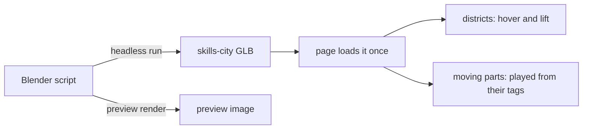
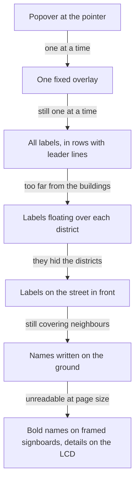

# The Homepage: a Sleeping Logo and a City of Skills

How the homepage intro, the isometric skills city under it and the LCD panel that describes each
district came to be, and the turns that did not work on the way. Rebuilding the city from its
source is a separate guide: [Rebuilding the Skills City](../guides/rebuilding-the-skills-city.md).

## The logo wakes up

The page opens on a dark room. The logo sleeps at the seam between wall and floor, turned towards
the room with its back to the wall. Half a second after the scene is ready it opens its eyes,
leans back, jumps to the centre, turns to face the camera in flight and lands on the CNOTV letters
as they appear, while the lights come up and the name fades in.

### The pose is a function of time, not a sequence of tweens

Every frame asks one question: given the seconds since the wake-up, where are the logo's feet,
how far is it leaning and turned, how open are its eyes and how bright is the room? The answer
comes from a short list of phases, each describing only its own slice of the motion.

| Phase        | Seconds after waking | What happens                                                    |
| ------------ | -------------------- | --------------------------------------------------------------- |
| Wake         | 0 to 0.9             | the eyes open, then blink once; the room is still dark          |
| Anticipation | 0.9 to 1.25          | the logo leans back, away from where it is about to jump        |
| Flight       | 1.25 to 1.9          | an arc to the centre, leaning into it and turning to face front |
| Settle       | 1.9 to 2.8           | a damped rock on landing; the letters appear under it           |
| Lights       | 0.9 to 2.8           | the room brightens throughout, ending in the awake look         |

Treating the intro as a pure function paid off three times. It is testable without a renderer.
Skipping it is trivial: a return visit in the same session asks for the pose "infinitely long
after waking", which is simply the final one. And no state machine has to remember where it was.

All motion pivots on the centre of the logo's base, so its feet stay planted while it leans and
turns. Classic squash and stretch was built first and removed: on a rigid logo it read as the mark
being distorted rather than as a character with weight.

### Eyes that are holes

The logo's eyes are holes through the extruded model. Opening and closing them uses lids made of
the logo's own material, hinged at their top edge. Placing the lids from the SVG artwork left a
sliver of each hole showing, because the exported model and the artwork do not line up exactly.
The lids are therefore sized and placed from the mesh itself: a small grid of rays is shot
straight through the face around each expected eye, and the rays that pass without touching the
front surface are the hole.

### Handing over to physics

After landing, the logo and letters become physics bodies again so they can be clicked and
knocked about. Three things went wrong before that handover was clean:

| Symptom                                    | Cause                                                                                                      |
| ------------------------------------------ | ---------------------------------------------------------------------------------------------------------- |
| Letters shoved aside the moment it landed  | the logo's body waited at its starting point, overlapping the letters; it now waits at the landing spot    |
| Clicked letters sank into the floor        | the old invisible walls rotated their meshes but not their colliders, so a floor collider cut through them |
| Letters bounced off the new floor collider | each letter's collider sat on its baseline, half below the glyph; the glyph geometry is now centred on it  |

## The city of skills

### Built in Blender, from a script

The city is one model, generated by a headless Blender script rather than modelled by hand. The
script was rerun dozens of times while the layout was argued over, and rerunning it reproduces the
committed model byte for byte, so the model never drifts from its source.

### How the layout got here

| Attempt                                          | What it taught                                                              |
| ------------------------------------------------ | --------------------------------------------------------------------------- |
| Eight square plots in a 4 by 2 grid              | reads as a board game, not a place                                          |
| A street grid with a waterfront                  | more city-like, but still a grid                                            |
| Districts scattered on an island                 | bare ground between them looked unfinished                                  |
| Overlapping, blended patches                     | no gaps, but no structure either                                            |
| Every point owned by its nearest district        | no bare ground, and streets fall naturally along the borders                |
| Districts in a ring of road on one piece of land | the final form: zones, a harbour on the sea, trees on whatever land is left |

Two ideas carry the final layout. Districts are placed in the camera's screen frame rather than on
the ground, in staggered rows, so each one owns a clear patch of the screen and the tall ones stand
at the back. And the land is divided by nearest site: each district takes the part of the city
limit closest to it, keeps a ring of that as road and is raised as a tile inside it, so neighbouring
rings meet as streets. The houses, warehouses and fuel tanks stand on the open land around the
districts and no longer look like districts of their own.

Every district's contents are scaled down, in small steps, until every vertex sits inside its own
tile and behind its sign. Shrinking around the district's site rather than the middle of its tile
made districts cut short by the coast shrink far more than they had to.

### Motion as data

Moving parts are tagged in Blender with what they do: a kind, an axis, a speed, an amount, a phase
and, for arcs, a height. The page reads the tags, checks each one, and plays it every frame without
knowing which building it belongs to. Adding motion to the city is a change to the model alone.

| Kind      | Used for                                                  |
| --------- | --------------------------------------------------------- |
| `spin`    | the orbiting packets, the globe, the ring sculpture       |
| `swing`   | robot heads and arms, the bell, the swing                 |
| `bob`     | crane trolleys, the shuttle cart, the harbour boat        |
| `slide`   | packages riding the conveyor into the truck               |
| `puff`    | chimney smoke and flying pages, rising and fading         |
| `grow`    | the loading bar on the frontend display                   |
| `stretch` | the bar chart on the same display                         |
| `pulse`   | signal lights and the antenna tip                         |
| `arc`     | fountain water leaving the bowl and falling into the pool |

Still meshes are joined per district to keep draw calls low; moving parts stay separate children of
their district so they lift with it on hover. A fading part gets its own copy of its material, or
fading it would fade every object sharing that material.

### Traps on the page side

| Symptom                                    | Cause                                                                                                |
| ------------------------------------------ | ---------------------------------------------------------------------------------------------------- |
| Hover lifted only part of a building       | a district with several materials loads as a group whose meshes reuse its name with a numeric suffix |
| The city filled half its frame             | framing a bounding box keeps its empty upper corners; framing the actual vertices does not           |
| The canvas floated over the next section   | the app positions every canvas absolutely for full-screen scenes; this one has to opt back in        |
| Type errors on a file that plainly existed | a helper and a component differing only by letter case, on a case-insensitive disk                   |

The city has its own canvas and animates only while it is on screen.

### Naming the districts

Labels were the hardest part to get right, and each attempt failed in a way that pointed at the next.

In a dense city, any flat label laid over the scene covers something. A name that is part of the
world reads best: a sign planted at the front of each district, standing up and facing the camera,
held in a metal frame so it does not look like it floats. Everything longer than a name moved to
the LCD panel, which only speaks when asked.

## The LCD panel

The panel is plain HTML and CSS over the corner of the city, not part of the 3D scene, so its text
stays crisp at any size and needs no texture work. Its look comes from four layers: a bezel, a dark
screen, a repeating gradient of thin dark lines for the scan lines, and a soft glow on the text.

The typing effect is a clip that uncovers the text in a fixed number of steps, from left to right,
with the description starting a moment after the title. Replaying it for every new district needs
one detail: the screen's content is keyed on the hovered district, so it is rebuilt each time and
its animation starts over. With nothing hovered it blinks a prompt; with reduced motion requested
it shows the text at once. The panel is hidden from screen readers, which get the same descriptions
as a list.
