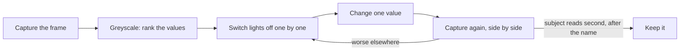
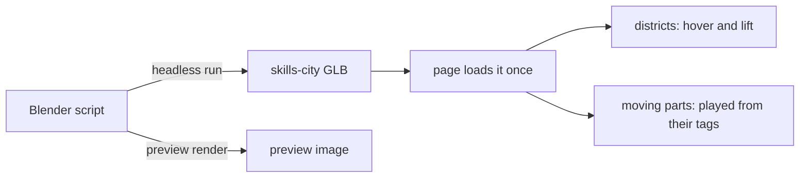
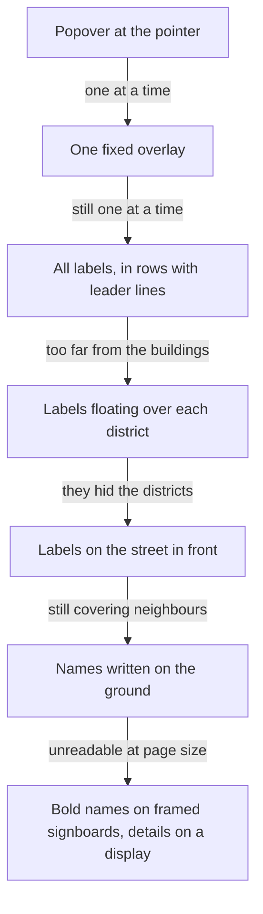

# The Homepage: a Sleeping Logo and a City of Skills

How the homepage intro, the isometric skills city under it and the LED display that describes each
district came to be, and the turns that did not work on the way. Rebuilding the city from its
source is a separate guide: [Rebuilding the Skills City](../guides/rebuilding-the-skills-city.md).

## The logo wakes up

The page opens on a dark room. The logo sleeps at the seam between wall and floor, turned towards
the room with its back to the wall. Half a second after the scene is ready it opens its eyes,
leans back, jumps to the centre, turns to face the camera in flight and lands on the CNOTV letters
as they appear, while the lights come up and the name fades in.

### The pose is a function of time, not a sequence of tweens

Every frame asks one question: given the seconds since the wake-up, where are the logo's feet,
how far is it leaning and turned, how open are its eyes and how bright is the room? The answer
comes from a short list of phases, each describing only its own slice of the motion.

| Phase        | Seconds after waking | What happens                                                    |
| ------------ | -------------------- | --------------------------------------------------------------- |
| Wake         | 0 to 0.9             | the eyes open, then blink once; the room is still dark          |
| Anticipation | 0.9 to 1.25          | the logo leans back, away from where it is about to jump        |
| Flight       | 1.25 to 1.9          | an arc to the centre, leaning into it and turning to face front |
| Settle       | 1.9 to 2.8           | a damped rock on landing; the letters appear under it           |
| Lights       | 0.9 to 2.8           | the room brightens throughout, ending in the awake look         |

The intro never holds the page: scrolling works from the first frame, and the arrow at the
bottom is a shortcut rather than the way out. On a phone that also meant giving touches on
the hero back to the page, since the disabled orbit controls still claimed them, and widening the
hero's view on an upright screen, where a fixed height cut the logo off at both sides. Scrolling away dims the room's lights first, then closes a
cover in the next section's colour over the hero, so the hero dissolves into the page below rather
than ending at a hard edge. The name and profession use the bold face of
the city's signs, tying the hero to the section below.

Treating the intro as a pure function paid off three times. It is testable without a renderer.
Skipping it is trivial: a return visit in the same session asks for the pose "infinitely long
after waking", which is simply the final one. And no state machine has to remember where it was.

All motion pivots on the centre of the logo's base, so its feet stay planted while it leans and
turns. Classic squash and stretch was built first and removed: on a rigid logo it read as the mark
being distorted rather than as a character with weight.

### Eyes that are holes

The logo's eyes are holes through the extruded model. Opening and closing them uses lids made of
the logo's own material, hinged at their top edge. Placing the lids from the SVG artwork left a
sliver of each hole showing, because the exported model and the artwork do not line up exactly.
The lids are therefore sized and placed from the mesh itself: a small grid of rays is shot
straight through the face around each expected eye, and the rays that pass without touching the
front surface are the hole.

### Handing over to physics

After landing, the logo and letters become physics bodies again so they can be clicked and
knocked about. Three things went wrong before that handover was clean:

| Symptom                                    | Cause                                                                                                      |
| ------------------------------------------ | ---------------------------------------------------------------------------------------------------------- |
| Letters shoved aside the moment it landed  | the logo's body waited at its starting point, overlapping the letters; it now waits at the landing spot    |
| Clicked letters sank into the floor        | the old invisible walls rotated their meshes but not their colliders, so a floor collider cut through them |
| Letters bounced off the new floor collider | each letter's collider sat on its baseline, half below the glyph; the glyph geometry is now centred on it  |

## Studying and correcting the light

The first lighting looked moody but made the logo the fourth thing the eye found, after the name,
a pool of light on empty floor and the logo's own shadow. Fixing it was less about taste than about
a repeatable way of looking, and that method is worth more than the final numbers.

### Look at values, not colours

Turn a screenshot to greyscale and stretch its contrast. Colour flatters a dark scene; values show
what the eye actually reads first. Then rank the brightest and darkest shapes. In a hero the name
should come first and the logo second; anything brighter or darker than the logo that is not the
logo is stealing attention.

In the before frame the largest dark shape is the shadow, and the brightest patch near the logo is
floor. In the after frame the logo is the clearest shape after the text, and its shadow is a soft
patch behind it.

### Find which light does what

Every visible effect comes from one light, and guessing which is how time gets lost. Switch them
off one at a time and watch what changes. The Lights panel in the app's debug view does this for
the ambient and key lights; the spot, the emboss and the paper are set in the view's
`config.ts`. During this pass the floor turned bright blue and the spotlight looked guilty; turning
lights off one by one showed it was the new rim light, which lit every upward surface, floor
included.

| Light    | What it does here                                                  | What to adjust                                                     |
| -------- | ------------------------------------------------------------------ | ------------------------------------------------------------------ |
| Ambient  | lifts everything evenly, flattening shape                          | keep low in a dark scene                                           |
| Key      | gives form and casts the main shadow                               | height sets shadow length, angle sets which surfaces it favours    |
| Spot     | makes the pool of light that frames the subject                    | aim, cone width and edge softness                                  |
| Emboss   | separates the subject's edges from the background, in its material | strength and the side it lights                                    |
| Material | how much light the subject returns                                 | a shade lighter than the background, a little gloss to catch edges |

### Read a shadow as a position

A shadow's length tells you the light's height, and its direction tells you where the light is.
The long shadow across the wall came from a key light only 3 units high; raising it and bringing it
round to the front put the shadow close behind the logo, where it gives depth without competing.
A shadow's edge says how soft it is: here plain PCF shadows with a blur radius, because the
"soft" variant ignores the radius entirely.

### Correct one thing, then compare

Change a single value, capture the same frame again and put it beside the previous one. Three of
this pass's changes made something else worse, and only the side-by-side caught it: a higher key
brightened the whole floor, a wider spot cone did the same, and the rim light did it worst of all.

### When a light cannot be contained

A directional light reaches every surface facing it; there is no way to point it at the logo
alone. The first fix for the logo's outline was a rim light from behind, and it lit the whole floor
blue. When an effect must touch only one object, it belongs in that object's material instead.

### From lighting to a material: navy cardstock

The final look stopped treating the logo as a lit object and made the whole scene one material: navy
cardstock. Wall, floor, logo and letters share a paper texture with a fine grain and short pressed
fibres, used both for colour and for bump, so light catches the paper's tooth. The logo is the same
card a shade lighter and fully matte, and it reads through an emboss in its own material: faces whose
edges lean towards the light come out lighter and those leaning away darker, like a pressed card
under a desk lamp. The light around it is soft: a wider shadow blur, a gentler spot, a little more
ambient, and the key from the upper left, the side the emboss lights.

A paper texture has one trap of its own: scale. Repeated densely, its fibres shrink below a pixel
and average out to flat colour; the texture only reads when one of its texels lands on roughly one
pixel of the screen.

### Every attempt kept as a preset

Each finish tried is kept as a preset, so they can be compared rather than remembered: the original
lighting, the first pass with a rim, navy cardstock, a light letterpress card with the logo in navy
ink, and two chromes reflecting the skills city: a dark satin one tuned by hand in the panel, with a
faint blurred reflection, and a polished dark mirror, also tuned by hand, with a stronger one. A glossy take and a layered cut-paper look were tried too and dropped.
The Config panel switches between them live, and an address such as `?look=letterpress` opens one
directly. Knocking the logo or the letters also moves the hero on to the next look
once they ease back into place, but only when something was actually knocked: the easing back runs
every few seconds regardless, so it checks first whether any piece was moved or turned. Everything a preset sets, the lights, the wall and floor, the logo's colour, emboss, rim
and paper, is also listed in the Elements panel, so a preset is a starting point to tune by hand
rather than a fixed answer. The Lights section recognises its lights by name, so the hero's spot is
named as the scene's spot light to join the ambient and key lights there instead of getting a row of
its own.

The panel's controls first looked frozen: a slider moved and snapped back. The panel redraws a
control only when the value it reads is reactive, and a three.js material is not, so every control
now reads a reactive copy of its values, updated on each edit and rebuilt on each preset switch.
The logo and the letters share one material, so they share one set of controls too.

A preset is plain data, one entry per look, and a switch blends from the look on screen to the next
over a second and a half instead of snapping. Every number, colour and light position is mixed
between the two each frame, with an ease in and out, and the result applied to the scene as it
stands: colours and lights change in place, and the emboss, rim and reflection are values the logo's
material reads every frame, so nothing is rebuilt. Two things cannot be mixed: the paper texture is
either on or off, and so is the navy ink the name and profession switch to on the light letterpress
card, since light text on cream would vanish. Both change at the halfway point, where the two looks
are closest, and the text eases its colour over the same second and a half in CSS. A switch that
arrives mid blend starts from wherever the blend had reached, so nothing jumps.

### A chrome logo that mirrors the city

The chrome preset reflects a short loop of the skills city, recorded from the page below and played
forward then backward so it loops without a jump. The obvious route, the video as a reflection map
the material lights itself with, failed twice. First the logo stayed black: three.js only prepares
a reflection map from an image whose height is above zero, and a video element's height is its HTML
attribute, zero until set, not the size of the footage. Then it reflected a single flat colour:
under an orthographic camera every point of a flat face looks in exactly the same direction, so a
mirror face shows one spot of the map, not a picture.

What works is closer to a real mirror in front of the scene: each face shows the footage at its own
place in the view, mirrored left to right, shifted by the face's tilt so the bevels and sides catch
other parts of it. The city barely moves, so the reflection also sways slowly sideways, as if the
logo caught a moving view. The video only plays while the chrome preset is on. A blur setting
turns the mirror into satin metal. Averaging a dozen samples along a spiral was tried first and
looked grainy rather than blurred; the blur now reads a smaller copy of each frame from the video's
mipmaps, the shrunken copies the GPU keeps of a texture, and smooths it with four close samples, so
it softens evenly at any strength.

## The city of skills

### Built in Blender, from a script

The city is one model, generated by a headless Blender script rather than modelled by hand. The
script was rerun dozens of times while the layout was argued over, and rerunning it reproduces the
committed model byte for byte, so the model never drifts from its source.

### How the layout got here

| Attempt                                          | What it taught                                                              |
| ------------------------------------------------ | --------------------------------------------------------------------------- |
| Eight square plots in a 4 by 2 grid              | reads as a board game, not a place                                          |
| A street grid with a waterfront                  | more city-like, but still a grid                                            |
| Districts scattered on an island                 | bare ground between them looked unfinished                                  |
| Overlapping, blended patches                     | no gaps, but no structure either                                            |
| Every point owned by its nearest district        | no bare ground, and streets fall naturally along the borders                |
| Districts in a ring of road on one piece of land | the final form: zones, a harbour on the sea, trees on whatever land is left |

Two ideas carry the final layout. Districts are placed in the camera's screen frame rather than on
the ground, in staggered rows, so each one owns a clear patch of the screen and the tall ones stand
at the back. And the land is divided by nearest site: each district takes the part of the city
limit closest to it, keeps a ring of that as road and is raised as a tile inside it, so neighbouring
rings meet as streets. The houses, warehouses and fuel tanks stand on the open land around the
districts and no longer look like districts of their own.

Every district's contents are scaled down, in small steps, until every vertex sits inside its own
tile and behind its sign. Shrinking around the district's site rather than the middle of its tile
made districts cut short by the coast shrink far more than they had to.

### Motion as data

Moving parts are tagged in Blender with what they do: a kind, an axis, a speed, an amount, a phase
and, for arcs, a height. The page reads the tags, checks each one, and plays it every frame without
knowing which building it belongs to. Adding motion to the city is a change to the model alone.

| Kind      | Used for                                                  |
| --------- | --------------------------------------------------------- |
| `spin`    | the orbiting packets, the globe, the ring sculpture       |
| `swing`   | robot heads and arms, the bell, the swing                 |
| `bob`     | crane trolleys, the shuttle cart, the harbour boat        |
| `slide`   | packages riding the conveyor into the truck               |
| `puff`    | chimney smoke and flying pages, rising and fading         |
| `grow`    | the loading bar on the frontend display                   |
| `stretch` | the bar chart on the same display                         |
| `pulse`   | signal lights and the antenna tip                         |
| `arc`     | fountain water leaving the bowl and falling into the pool |
| `route`   | the boat sailing between the harbour and the dock         |

Still meshes are joined per district to keep draw calls low; moving parts stay separate children of
their district so they lift with it on hover. A fading part gets its own copy of its material, or
fading it would fade every object sharing that material.

### Traps on the page side

| Symptom                                    | Cause                                                                                                |
| ------------------------------------------ | ---------------------------------------------------------------------------------------------------- |
| Hover lifted only part of a building       | a district with several materials loads as a group whose meshes reuse its name with a numeric suffix |
| The city filled half its frame             | framing a bounding box keeps its empty upper corners; framing the actual vertices does not           |
| The canvas floated over the next section   | the app positions every canvas absolutely for full-screen scenes; this one has to opt back in        |
| Type errors on a file that plainly existed | a helper and a component differing only by letter case, on a case-insensitive disk                   |

The city has its own canvas and animates only while it is on screen.

### Naming the districts

Labels were the hardest part to get right, and each attempt failed in a way that pointed at the next.

In a dense city, any flat label laid over the scene covers something. A name that is part of the
world reads best: a sign planted at the front of each district, standing up and facing the camera,
held in a metal frame so it does not look like it floats. Everything longer than a name moved to
the LED display, which only speaks when asked.

## The LED display

The display began as a panel in the corner of the canvas, then moved onto a big framed screen
standing behind the city, which also carries the section's heading while nothing is hovered. The
screen is in the model; the text is not. Blender builds a blank board and marks its centre and size
on an empty node, and the page projects the board's four corners through the camera and lays an
HTML element exactly over them. Because the board faces the camera azimuth and the camera is
orthographic, those corners always land on an upright rectangle, so no perspective transform is
needed and the text stays sharp at any size with no texture work. The rectangle is recomputed only
when the canvas is resized, since nothing moves the sign.

Its text is sized in container units of that rectangle, so it scales with the city. A hovered district shows only its description, since its sign already names
it. On a phone the screen is too small for a sentence and the signs too small to read, so it shows
the name instead; the full descriptions stay in the page
as a list for screen readers. The look comes from three layers: a dark surface, a repeating gradient
of thin dark lines for the scan lines, and a soft glow on the text. The sign's metal frame is the
bezel.

The typing effect is a clip that uncovers the text in a fixed number of steps, from left to right,
with the description starting a moment after the title. Replaying it for every new district needs
one detail: the screen's content is keyed on the hovered district, so it is rebuilt each time and
its animation starts over. With nothing hovered it shows the section heading; with reduced motion requested
it shows the text at once. The panel is hidden from screen readers, which get the same descriptions
as a list.

## A drawer for recruiters

Clicking a district opens a drawer that presents the skill to someone hiring: the tools and
practices as a short row of tags, then highlights from real roles, grouped under each company and its years, with the
company linked to its LinkedIn page, written results first so the number or the outcome comes
before the method. A recommendation, where there is one, closes the drawer as a pull quote linked
to its source. Every line is
taken from the owner's own experience; a district with little to say says little rather than being
padded. The district stays lifted while its drawer is open, so it is clear what the drawer is about.

The UI kit's sheet was the obvious candidate and the wrong one: it hosts the side panels, renders
into their containers and deliberately ignores Escape and clicks outside. The drawer instead uses
the same dialog primitives directly, so it is modal, keeps focus inside, closes on Escape, the
overlay or its close button, and hands focus back afterwards. The districts live on a canvas,
which a keyboard cannot reach, so the page also lists them as buttons that stay hidden until one
receives focus and then appear as a row under the city.

## Lines to the market

The sectors the products serve have no heading of their own: a boat sails from the harbour round
the island to a dock at its southern tip, and dotted lines fan out from that dock to six small 3D
avatars, one per sector, with the dots marching towards them. The lines are an SVG drawn behind
the section from where the avatars actually are, and redrawn whenever the list changes size.

The first version was a circuit board: orthogonal traces routed down lanes between a grid of
cells, with rules about which trace turns off highest so none would cross. It read as wiring
rather than as an outcome reaching a market. Small avatars in a row make the fan-out the whole
picture, and a curve that leaves straight down and arrives straight down needs no routing at all.
On a phone the six sit in two staggered rows, the second shifted by half an avatar, so each line
to the second row drops through a gap in the first instead of across an avatar.

The dock and the lines live in different worlds, one in the 3D model and one in the page, and
nothing measures one against the other. They meet because the camera frames the whole model and
its widest part is the sea: a point halfway across the sea always lands in the middle of the
canvas, whatever its size, which is where the lines start. The boat's course is stored on the
model as a list of points, like the other motion tags, so the page sails it without knowing it
is a boat.

Each avatar is a small 3D model built by its own Blender script, in the city's palette: a bank,
a telecom mast, a stack of publications, the scales of governance, a shield and a town hall. Six
canvases would mean six WebGL contexts, and browsers cap how many a page may hold, so one canvas
covers the whole section and each model is drawn only into the square over its circle, with its
own camera, before the next. The models stand still, so the canvas is drawn again only when the
section changes size. Arrowheads, circle outlines and a gentle to-and-fro turn were all tried and
dropped: each competed with the models for attention. Drawing only on demand also exposed a
trap: three.js sets its clear colour inside `render()`, so a manual clear before the first render
filled the whole canvas with opaque black until the colour was set to transparent up front.

The lines measure the avatars the same way, once per resize, by their offsets summed up through
every offset parent to the section, so a transformed ancestor on the way cannot leave them short.

## A map behind it all

Below the hero, the city and the market stand on a faint topographic map: contours of a slowly
drifting noise field, drawn in dots to match the lines to the market, and kept close to the page
colour so it reads as texture rather than content. It is a single shader on a canvas the size of
the screen that sticks behind the content as it scrolls past, and shifts the map by how far the
content has moved, so a long page costs no more than one screen.

Two details made it work. Each dot cell asks whether a contour passes through it in screen pixels,
not in height, so contours stay one dot wide on steep and flat ground alike; a height threshold
drew thin rows on slopes and broad clumps on the flats. And a shader material receives its colours
in linear space and must convert them back for the screen, or the whole map comes out darker than
the colours it was given.

On a phone held upright the city is too small to read its districts, so a small phone icon above
it tips over to suggest landscape. It sits outside the city's own frame: inside, it would push the
canvas down and misplace the screen display, which is positioned as a share of that frame.
