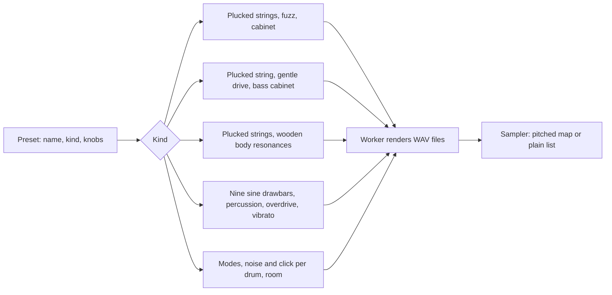
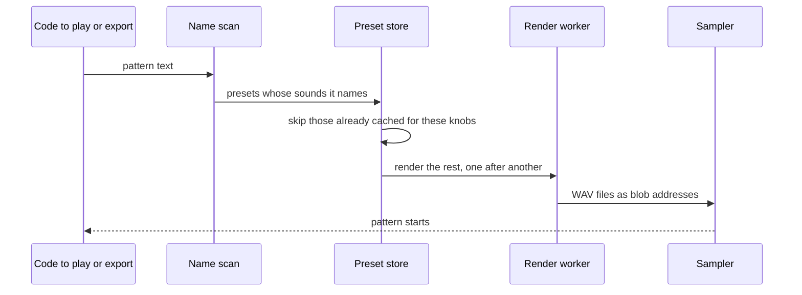

# Instrument kinds and presets

The [stoner guitar](./stoner-guitar.md) grew into five kinds of instrument that a song can mix: electric guitar, bass guitar, acoustic guitar, organ and drum kit. This page records why they are built the way they are and what was measured. It does not say how they sound: nothing here was listened to.

## One preset, one set of sounds

A preset is a name, a kind and five knobs between 0 and 1. It registers one sound for each articulation of its kind, named after the preset, so `chainsaw` and `stoner` are two different guitars in one song. Each kind is data: its knobs with their labels, its articulations with the notes they are sampled at and their lengths, and the constants of its signal chain. The render code picks the chain by kind.

## Why presets render lazily

A preset bank costs a few seconds of worker time and tens of megabytes of decoded audio. Eleven presets rendered at load would cost about fifteen seconds of work and several hundred megabytes before anyone pressed Play, on a machine that may be a phone. So a preset renders in two cases only: it is selected in the tab, or the code about to play or export names one of its sounds. The code is scanned for the sound names, each referenced preset is rendered, and the pattern starts after they are all ready. The same path serves the offline export, which is why the export script produces the same file as playback without any extra step.

A render is cached by preset name and knob values, so playing again costs nothing, and editing a slider renders only the edited preset. Renders run one behind another, so two quick edits never register out of order. A failed render is recorded on the preset and leaves every other sound working.

## Why the built-in presets ship in configuration

An example song has to sound the same for everyone, so its presets cannot depend on what is in one person's browser. The eleven built-in presets are literal data in the configuration. A tweak is saved apart from the preset as a difference, and Reset removes it, so the shipped values are never overwritten and a later release can improve a preset for people who never touched it. The presets a person makes are saved as they are.

A preset name becomes the front of its sound names, so it is checked: lowercase letters and digits, a letter first, unique, and not a sound Strudel already has. Collisions are checked against the live sound map, with the presets' own sounds left out, since a preset's name is not taken by itself.

## The models

The plucked string is the same extended Karplus-Strong loop for the three string kinds. What differs is data: the bass is an octave lower with a finger or pick attack set by how soft the noise burst is, the acoustic spreads the strings of a chord over 4 to 30 ms and adds three wooden resonances near 100, 200 and 400 Hz instead of a fuzz and cabinet. Drive at zero keeps the clipping stages nearly linear, so the same chain gives a clean guitar.

The organ is additive: nine sine drawbars at the tonewheel footages, with the low three set by one knob and the upper six by another. Percussion is a decaying third harmonic and a short filtered click. A soft overdrive follows, then a vibrato made from a slowly swept delay mixed with the dry sound, started at a different point in each channel.

The drums are modal and noise synthesis. A membrane is a few damped sines that start high and fall, which gives a kick its thump and a tom its pitch. A snare adds filtered noise for the wires. The cymbals are sums of inharmonic sine partials with filtered noise, the crash longer and noisier. Drive saturates, and the room is four darkened early reflections per side at different delays for left and right, which is cheap and gives a stereo image. A tight, clicky kit and a big roomy one differ only in the knobs.

## Measurements

Render time in headless Chromium, through the worker, for the whole bank of each preset.

| Preset     | Kind            | Sounds | Render time |
| ---------- | --------------- | ------ | ----------- |
| stoner     | electric guitar | 34     | 2.8 s       |
| seattle    | electric guitar | 34     | 2.1 s       |
| jangle     | electric guitar | 34     | 2.1 s       |
| chainsaw   | electric guitar | 34     | 2.2 s       |
| fuzzbass   | bass guitar     | 20     | 0.8 s       |
| grungebass | bass guitar     | 20     | 0.8 s       |
| deathbass  | bass guitar     | 20     | 0.8 s       |
| campfire   | acoustic guitar | 34     | 0.8 s       |
| doomorgan  | organ           | 13     | 0.7 s       |
| garagekit  | drum kit        | 9      | 0.2 s       |
| blastkit   | drum kit        | 9      | 0.2 s       |

The articulations of one preset of each new kind were exported through the editor, one repetition each, and measured. All 18 have no lead silence, a last sample of exactly 0 and a true peak between -2.5 and -5.9 dBFS at the editor's default gain. The hats and cymbals sit 30 to 42 dB above their bass band in the air band, and the kick holds its energy in the bass and sub bands, as intended.

Automated tests check each kind: pitch within 10 cents by autocorrelation from a0 to c5, a kick with most of its energy under 150 Hz, hats with most of theirs above 5 kHz, silent ends, the peak, and the same samples for the same seed.

## Why a note ends with its event

The Instruments tab sounded right and the same preset sounded harsh and unfiltered once a Voice node played notes imported from a tab. Nothing in the tone differed. The difference was length: the preview cut every hit at the end of its event, while a pattern let every note ring its whole sample, up to four seconds of fuzz. A plain line of eighth notes therefore stacked a couple of dozen tails, summed past full scale and clipped in the output, and digital clipping reads as exactly the missing cabinet the listener hears.

A pitched preset note now ends with its event, as a General MIDI soundfont note does, unless the pattern says how long it lasts with `clip`, `legato`, `release`, `loop` or `cut`. Drums keep ringing their whole sample, since a cymbal cut at a sixteenth note sounds broken. The rendered strings and organ also sit at -7 dBFS instead of -1, because a tab line often holds two or three notes at once and each one is a full mix of a distorted chord; the songs' own gains were doubled to match, so they are unchanged.

| Same tab line on `chainsaw_note`, default gain | True peak          | Loudness             |
| ---------------------------------------------- | ------------------ | -------------------- |
| Every note rings its whole sample              | +0.4 dBFS          | -0.1 LUFS            |
| Notes end with their event                     | -0.7 dBFS          | -7.0 LUFS            |
| And the samples sit 6 dB lower                 | -6.7 dBFS          | -13.1 LUFS           |
| Three note shapes at default gain              | -0.4 dBFS          | -10.1 LUFS           |
| Hollow Chambers, before and after              | -1.6 and -1.4 dBFS | -12.3 and -12.6 LUFS |

## Why a preset is one instrument with techniques

The Instruments tab played a preset as one instrument, while the flow editor's pickers listed it as three sounds, one per playing technique. Each of those sounded wrong on its own: a tab line played on the power chord sound turned every note into a three-note chord, and on the palm mute sound everything came out choked. The preview was a phrase that mixed the techniques, so nothing the picker offered matched what the tab promised.

The preview later had the same flaw from the other side: it played a phrase with its own notes, gains and tempo, while the tab showed a one line hint, so pasting the hint into the editor sounded different. The tab now shows one complete example per kind, and that exact text is what Copy writes, what play renders and what Download saves, so the preview is the code and nothing hides in the tab. Because the example sets its own tempo and any gain, the editor renders the same bytes.

A preset is now also one sound named after it. Each sampled note holds the technique samples in a fixed order, and the technique's name chooses between them, as `chainsaw:mute`, which the combined sound turns into the sample index before it plays: nothing for a single note, then palm mute, then power chord. Mini notation hands the word over as the index, and an unknown word falls back to the single note. Where a technique has no sample at a pitch, because the chord and mute samples stop an octave below the single notes, the single note fills the slot so an index means the same technique across the whole range. The older per technique names remain, since the songs fix one technique for a whole part. Superdough takes the sound and the index apart where Strudel's control splits them, so the picker's preview does the same split before it plays.

## Why the flow pickers list the presets themselves

The flow editor's sound pickers were built from the sounds registered with the sampler, and a preset registers its sounds only once it renders. So a preset nobody had played yet was missing from the Voice node, and a notes line imported from a tab could not be put on it; searching for it found nothing. The pickers now list every preset from the presets, rendered or not, pitched kinds on the Voice node and drum kits on the sample nodes, and leave out the registered copies so nothing shows twice.

Three smaller traps came with it. A preset's name says nothing about what it is, so the picker could not file `chainsaw` under guitars from the name the way it files `rolandtr909_bd` under kicks; a picker option may now carry its family. The picker's play button looked the sound up in the registered list and did nothing when it was missing, so an unrendered preset was silent; it now previews it anyway and the preview renders the preset first. And the picker opens on the family of the current sound, so a search typed from a synth found no guitar; typing now widens the search to every family.

## The tempo checks

A genre at the wrong speed reads as another genre, so each song's BPM is written in its first line and in the tempo call, and then measured from its MIDI export: the shortest gap between onsets on the busiest pitched track, multiplied back to beats. Sun Bleached, Paper Skies and Hollow Chambers measure 96.00, 112.00 and 200.00. At 200 BPM a sixteenth is 75 ms, shorter than any drum or string sample, so every tremolo, gallop and blast event is clipped to its length and the open hat and cymbals are choked. See [genre songs](./strudel-genre-songs.md).

## What is not checked

Nobody has listened to any of it. The tone defaults, the balance of the three songs and whether the death metal kit is clicky enough are guesses made from numbers.
