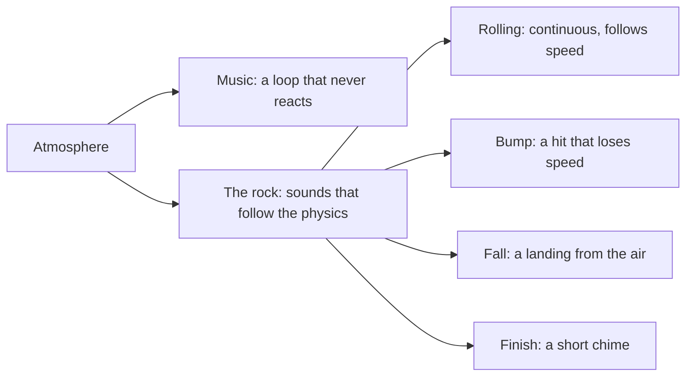

# The sound of Rock Runner

The first soundtrack was a square wave arpeggio over a drum machine, and the second, a slow
pad drone, was too still for a platformer, and a third at 112 beats a minute was still not
energetic enough for a running game. The first was in tune and on the
beat and it sounded like a different game: Rock Runner is a heavy stone rolling through a
wood, drawn in ink on cream paper, and nothing about 8-bit chip music says any of that.
This page fixes the atmosphere before any sound is made, so each sound can be judged against it
rather than against taste on the day.

## Atmosphere

A **quiet forest, seen from low down, with a great weight moving through it**. Calm and
slightly ominous, but always moving: the rock is unstoppable and a running game needs forward
drive and energy. Soft and organic
rather than bright and electronic.

| Quality        | Means                                                                                                                                            | Rules out                                       |
| -------------- | ------------------------------------------------------------------------------------------------------------------------------------------------ | ----------------------------------------------- |
| Natural        | wind, wood, breath, bells of wood and glass, slow soft pads                                                                                      | square and saw leads, chip arpeggios            |
| Spacious       | long attacks, long releases, a lot of reverb                                                                                                     | dry, tight, rhythmic loops                      |
| Weighty        | low frequencies carry the rock; the highs are small and far away                                                                                 | thin or high sound for anything the rock does   |
| Energetic      | about 140 beats a minute: a steady wooden pulse, a running bass and a fast kalimba arpeggio, so the song keeps pace with a player who is running | a still drone the player outruns, or a drum kit |
| Gently ominous | a minor, open harmony that never fully resolves                                                                                                  | bright major fanfares                           |

## The music has two sections

One section repeated for half a minute is a loop you stop hearing. The theme is two sections of
sixteen bars that swap forever: the first is the minor home (Am, F, C, G) with the flute
carrying a calm tune, and the second lifts to a different harmony (Dm, F, G, E) with a
syncopated taiko, doubled woodblock, sixteenth shaker and a higher kalimba and flute, so it
pushes harder before falling back to the first. Both come from one file, so the join is always on a
chord change and the whole loop is under a minute.

Every part changes chord once a bar, together. The first version looped each part's chord list at
its own speed, so the pad held one chord while the flute passed through two, the kalimba four and
the bass eight, and over half the bass and kalimba notes sat outside the chord under them. In the
second section that put the G sharp of its last chord over all the others. The two sections also
differ in the flute now: one phrase a bar in the first, calm, and the same phrase twice in the
second.

## Two layers

The sound splits by who makes it, because they need different tools.

The music is a single looping file under the rest. Everything the rock does is made from its
own motion, every frame, so a sound is always the size of the thing that happened.

## What each rock sound is

| Sound   | Made of                                                                                                    | Driven by                                        |
| ------- | ---------------------------------------------------------------------------------------------------------- | ------------------------------------------------ |
| Rolling | a heavy rumble with hiccups: dark noise that drops out now and then, uneven thuds, small jolts and pebbles | volume and pitch follow speed; silent in the air |
| Bump    | a short wooden thud with a little stone grit                                                               | how much speed a single frame lost sideways      |
| Fall    | a dry, dense thud: a short low sine, a stone crack and a brief tremble                                     | how fast the rock was falling when it landed     |
| Finish  | a soft music box chime over a warm pad                                                                     | the run ending                                   |

The fall is the big one, and it is easy to get wrong in two ways. A long pure low sine reads as
a hollow drum, not a rock, and anything with a tail reads as an echo in a cave. A stone landing
is dense and dry: a short low thump for the weight, a bright crack of noise for the stone, and a
brief tremble, all over within about half a second. The rolling sound had four traps. Smooth filtered noise is a vacuum cleaner, a narrow resonant
band whines, a steady low pulse is an engine idling, as if the rock were a 4x4, and a swelling
mid-range layer is a whoosh. Shaking the level hard at random, to avoid the engine, then reads as
vibration. A boulder is heavy and mostly calm: dark low noise barely varying, a slow uneven thump
each time a heavy side comes round, a few pebbles, and the odd hiccup, where the noise drops
out for a beat and a small jolt follows, as the rock skips over uneven ground. Playing it faster still makes it follow
the rock's speed.

## Why detection comes from velocity

Nothing in the run listens to physics contacts, and adding a contact event queue for sound alone
would touch the hot path. Both impacts are readable from two consecutive frames of velocity: a
landing is the frame where the rock goes from airborne to resting while moving down, and a bump
is a frame where horizontal speed drops sharply without a landing. A threshold keeps ordinary
rolling over the slope from sounding like hits, and the loudness scales with the size of the
change so a graze and a slam are not the same sound.

## Playing it without stutter

Every sound is rendered once and shipped as a file, so the game never runs Strudel. A first
version played each impact by creating a fresh audio element, and a rock grinding along a wall
could trigger a bump on many frames in a row; the browser decoded the same file over and over
and the sound stuttered. The effects are now decoded once into memory and played from there,
each kind has a short cooldown so a burst of detections is one sound, and the rumble is one
looping source whose volume and pitch are eased toward their target. Only the music, the one
long file, streams. Music and sound effects can each be switched off with the two icons in the top left corner of the run, a plain icon when on and a barred one when off.

## Where a render stops

A render ends exactly at the end of its last cycle and cuts off whatever is still sounding, which
did damage in two places. The rumble loop dropped from a third of full scale straight to silence
on every repeat, a step 28 times larger than any inside the file. Its seam is now a 30 millisecond
crossfade of the file's own end into its start, at constant power because the two are unrelated
noise. That leaves the sound itself untouched and shortens the loop to 1.97 seconds, which nothing
depends on, since its pitch follows the rock anyway. The finish chime stopped dead at full level
for the same reason, so it is rendered with an empty second cycle for its reverb and release to
ring out in.
