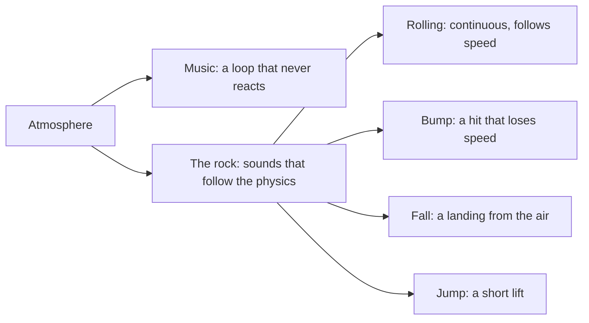

# The sound of Rock Runner

The first soundtrack was a square wave arpeggio over a drum machine, and the second, a slow
pad drone, was too still for a platformer, and a third at 112 beats a minute was still not
energetic enough for a running game. The first was in tune and on the
beat and it sounded like a different game: Rock Runner is a heavy stone rolling through a
wood, drawn in ink on cream paper, and nothing about 8-bit chip music says any of that.
This page fixes the atmosphere before any sound is made, so each sound can be judged against it
rather than against taste on the day.

## Atmosphere

A **quiet forest, seen from low down, with a great weight moving through it**. Calm and
slightly ominous, but always moving: the rock is unstoppable and a running game needs forward
drive and energy. Soft and organic
rather than bright and electronic.

| Quality        | Means                                                                                                                                            | Rules out                                       |
| -------------- | ------------------------------------------------------------------------------------------------------------------------------------------------ | ----------------------------------------------- |
| Natural        | wind, wood, breath, bells of wood and glass, slow soft pads                                                                                      | square and saw leads, chip arpeggios            |
| Spacious       | long attacks, long releases, a lot of reverb                                                                                                     | dry, tight, rhythmic loops                      |
| Weighty        | low frequencies carry the rock; the highs are small and far away                                                                                 | thin or high sound for anything the rock does   |
| Energetic      | about 140 beats a minute: a steady wooden pulse, a running bass and a fast kalimba arpeggio, so the song keeps pace with a player who is running | a still drone the player outruns, or a drum kit |
| Gently ominous | a minor, open harmony that never fully resolves                                                                                                  | bright major fanfares                           |

## Two layers

The sound splits by who makes it, because they need different tools.

The music is a single looping file under the rest. Everything the rock does is made from its
own motion, every frame, so a sound is always the size of the thing that happened.

## What each rock sound is

| Sound   | Made of                                                             | Driven by                                        |
| ------- | ------------------------------------------------------------------- | ------------------------------------------------ |
| Rolling | low brown noise, a grinding rumble, looped without a seam           | volume and pitch follow speed; silent in the air |
| Bump    | a short wooden thud with a little stone grit                        | how much speed a single frame lost sideways      |
| Fall    | a deep sine that drops in pitch, a noise burst, then a slow tremble | how fast the rock was falling when it landed     |
| Jump    | a short airy lift                                                   | the jump itself                                  |

The fall is the big one. A rock this size landing should be felt more than heard: a boom with
most of its energy below what small speakers can play, followed by a tremble that decays over
about a second, as the ground settles.

## Why detection comes from velocity

Nothing in the run listens to physics contacts, and adding a contact event queue for sound alone
would touch the hot path. Both impacts are readable from two consecutive frames of velocity: a
landing is the frame where the rock goes from airborne to resting while moving down, and a bump
is a frame where horizontal speed drops sharply without a landing. A threshold keeps ordinary
rolling over the slope from sounding like hits, and the loudness scales with the size of the
change so a graze and a slam are not the same sound.

## Playing it without stutter

Every sound is rendered once and shipped as a file, so the game never runs Strudel. A first
version played each impact by creating a fresh audio element, and a rock grinding along a wall
could trigger a bump on many frames in a row; the browser decoded the same file over and over
and the sound stuttered. The effects are now decoded once into memory and played from there,
each kind has a short cooldown so a burst of detections is one sound, and the rumble is one
looping source whose volume and pitch are eased toward their target. Only the music, the one
long file, streams. Music and sound effects can each be switched off from the Config panel.
