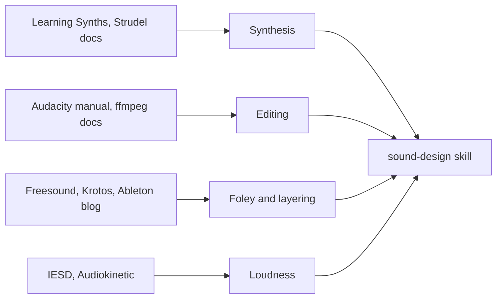

# Sound design sources

The `sound-design` skill keeps only what an agent needs while working. This page holds what its
sources actually say, source by source and in our own words, so the skill can stay short and a
claim in it can be traced. Numbers are the sources' own unless a row says we measured them.

## Synthesis

### Ableton Learning Synths

[Learning Synths](https://learningsynths.ableton.com/) teaches on one playable browser synth, in
this order: get started, making changes, synth basics, envelopes, LFOs, oscillators, filters,
recipes, a playground, and where to go next. Envelopes and LFOs come before oscillators and filters,
the reverse of the order our curriculum uses, so a learner following both sees them swapped.

| Idea            | What it teaches                                                                                                              |
| --------------- | ---------------------------------------------------------------------------------------------------------------------------- |
| Envelope        | Decay is the time from peak down to the sustain level; with sustain at maximum, decay does nothing                           |
| LFO shape       | Sine rolls, saw ramps, square jumps; the shape changes the character of the movement                                         |
| Waveform        | Square reads as hollow or woody, saw as buzzy or bright; a wave's height is loudness, not timbre                             |
| Fast modulation | The key lesson: slow modulation is heard as behaviour, and fast modulation is heard as a change of timbre, harsh or metallic |
| Resonance       | A boost around the cutoff; high values whistle, and the whistle follows the cutoff                                           |

Its recipes are worked settings for that synth, useful as starting ratios:

| Recipe       | How it is built                                                                                                                             |
| ------------ | ------------------------------------------------------------------------------------------------------------------------------------------- |
| Plucked bass | Sustain 0, decay about 1.2 s; low-pass near 245 Hz, no resonance, opened by a fast envelope. A very short decay adds a snap                 |
| Laser        | Pitch envelope of 48 semitones; pitch and amplitude share one envelope, so the sound ends as the pitch lands; low-pass follows              |
| Kick         | The laser with a far faster pitch envelope (about 75 ms) of about 22 semitones, and amplitude left to ring on after it                      |
| Sub bass     | Low-pass at 200 Hz with resonance and a fast envelope for the thump; a saw an octave under a square, 5 cents sharp, for swirl               |
| Hi-hat       | Noise only, a closed filter opened by a decay of about 50 ms; a little random LFO changes each note; a touch of very high square adds metal |
| Strings      | Attack and release about 750 ms, sustain full; the filter opens more slowly than the amplitude, then vibrato                                |
| Noisy lead   | A saw just under an octave above a square, and a pitch envelope sliding into each note: the so-called Hoover                                |
| Distortion   | Amplitude modulated at an audio rate; notes unrelated to that rate turn harsher than related ones                                           |

The kick and the laser being nearly one patch is worth remembering: a percussive sound is often a
pitched sound with its envelopes shortened.

### Strudel

[The synths page](https://strudel.cc/learn/synths/) covers the methods Strudel offers. FM has an
index (`fm`), a ratio (`fmh`) and its own envelope, with up to eight operators by number suffix.
Wavetables are ordinary sounds with a `wt_` prefix, loop by default, and come from a set of over a
thousand. Noise is `white`, `pink`, `brown` or `crackle`, and `noise` mixes pink noise into any
oscillator. Additive is `partials`, one magnitude per harmonic, with `phases` for their starts.

[The effects page](https://strudel.cc/learn/effects/) confirms the trap we hit: effects are read
when a sound event starts, so a signal on a filter is sampled once per event and does not sweep.
It names what does move inside a note: amplitude, pitch, FM and filter envelopes, `tremolo`,
`phaser` and `vib`. It also warns that delay feedback at 1 or more grows without limit, that
changing `roomsize` recalculates the reverb, and that patterns on one `orbit` share a delay and a
reverb.

We measured one thing the page leaves out: `.segment()` on the filter's argument does not help,
because the sound still owns the events. It has to go on the sound itself.

### Wavetable

[Audeobox](https://www.audeobox.com/learn/glossary/wavetable/) describes a table as a run of
single-cycle snapshots, with a position control that blends neighbours. Moving the position is the
whole point: an envelope on it gives a bass a bright start that settles, and a slow scan keeps a
held note alive.

## Editing

### Audacity

| Page                                                                                                            | What it says                                                                                                                                                                            |
| --------------------------------------------------------------------------------------------------------------- | --------------------------------------------------------------------------------------------------------------------------------------------------------------------------------------- |
| [Noise Reduction](https://manual.audacityteam.org/man/noise_reduction.html)                                     | Profile on noise alone, then reduce. Defaults 6 dB, sensitivity 6, smoothing 6 bands. Use the lowest values that work. Residue plays what is removed. The profile dies with the session |
| [Notch Filter](https://manual.audacityteam.org/man/notch_filter.html)                                           | Default 60 Hz, Q 1. Use 60 Hz in North America, 50 Hz in most other places. Q of about 2 to 10, higher on higher harmonics. Then mild Noise Reduction if anything remains               |
| [Plot Spectrum](https://manual.audacityteam.org/man/plot_spectrum.html)                                         | Find the tallest peak. A larger size separates close frequencies but averages over more time. Keep the Hann window; use a linear axis for high harmonics                                |
| [Spectral Selection](https://manual.audacityteam.org/man/spectral_selection.html)                               | A box of time and frequency, in Spectrogram view. Only spectral effects use the range. Meant for one steady frequency with few harmonics, not broad noise such as traffic               |
| [Spectral Edit Multi Tool](https://www.audacityteam.org/manual/effects/spectral-tools/spectral-edit-multi-tool) | Notches the middle of the selection, or high-passes or low-passes with one bound set. Fades 10 ms at each end. Fails on a very low bound with a very wide selection                     |
| [Envelope Tool](https://manual.audacityteam.org/man/envelope_tool.html)                                         | Volume over time without touching samples, until Mix and Render bakes it in. Its curves cannot fade fully to silence: use a fade effect. Several filters remove it, so render first     |
| [Clips](https://www.audacityteam.org/manual/clips)                                                              | Trimming hides audio rather than deleting it, so dragging back restores it. Clip gain is a curve on the clip. Current manual, updated October 2026                                      |

The manual records a bug worth knowing: applying Notch Filter or Noise Reduction can remove an
envelope, returning the audio to full level.

### ffmpeg

[The filter reference](https://ffmpeg.org/ffmpeg-filters.html) gives `afftdn` a reduction `nr`
(default 12 dB) and a noise floor `nf` (default -50 dB, range -80 to -20), and uses the phase-free
`afftfilt` chain as its robot example. We ran every chain in the skill on a test recording. A
voice with hum and hiss went from a floor of -12.7 dB to -46.5 dB with notches and -65.6 dB with
`afftdn`, the voice staying at -19 dB. Its `sn` noise sampling command had no effect in that test.

## Foley and layering

### Freesound

[The FAQ](https://freesound.org/help/faq/) sets the terms. CC0 asks only that nobody claims
authorship. Attribution needs a credit: sound name, uploader, URL and license, and a long list may
link to a page. NonCommercial cannot earn money. The old Sampling+ license also bars commercial
advertising. An account's [attribution list](https://freesound.org/home/attribution/) records
every download, which helps with credits.

Previews are low-bitrate, so judge a sound from its download, which is the exact uploaded file. The
site is for sounds, not songs: recordings of commercial music, broadcasts, game audio and synth
presets do not belong there, so a sound that seems to be one of those is a licensing risk whatever
its label says. Good descriptions work in four levels: the overall event, the events inside it,
timbre and envelope, and the recording setup. AI training follows each sound's license, with
extra opt-outs set by uploaders.

[The API](https://freesound.org/docs/api/resources_apiv2.html) searches at `/apiv2/search/`, which
replaced the older text search in November 2025. `license` is filterable, and `fields` must list
everything wanted, previews included. Originals need OAuth2.

### Krotos

[Their foley guide](https://krotos.studio/blog/foley-film) starts before recording: watch locked
picture, mark sync points, and list props, surfaces and footwear. Record in a quiet room with mics
fixed between takes, slate each take, and record feet, moves and props as separate passes. Keep
processing light, deliver stems rather than one mix, and check for drift and phase before handing
over. It gives no dB targets: levels are set against picture.

[Their footsteps guide](https://krotos.studio/blog/footsteps-sound-effects) is the most concrete.
Real footwear on the real surface beats EQ, since footwear changes the sound most. One mono mic at
30 to 60 cm is enough. Cut on the impact transient, and sync to the frame of contact. Treat a step
as attack, body and space. Distance is mostly level and ambience: strong and dry close up, quieter
and wetter far off. Thin or phasey layers are fixed by aligning transients and checking in mono,
and a wrong shoe by replacing the source.

### Game sounds

[Violet Recording](https://violetrecording.com/how-to-design-sound-effects-for-games/) gives the
game view. UI sounds stay short, quiet and tonal; pickups rise in pitch with something sparkly on
top; impacts go attack, body, short boom; abilities carry a readable whoosh or charge. Loops keep
standout events out, since they repeat, and join at zero crossings with a crossfade. Positional
sounds ship mono. Test in play rather than soloed, and listen for fatigue over several minutes.

### Cinematic hits

[Ableton's article](https://www.ableton.com/en/blog/learn-how-to-make-high-impact-sounds-for-movies-and-trailers/)
names the vocabulary: hits, risers, whooshes, braams, subs. A hit starts from a kick or taiko with
its highs removed, adds metal or orchestral layers above and sub below, each equalised alone. A
riser climbs in pitch and filter while an LFO speeds up, and ends on a hit or a brief silence.
Atmospheres come from stretching and pitching down existing audio, high sample rates first.
Recorded foley gets a spectral denoise and an EQ for rumble before layering. Distortion is followed
by EQ and compression to tame what it adds. A braam stacks low brass near C1 to C2 at octaves, with
distortion moving on a layer and the pitch dropping. Everything finishes wide: pan the layers,
compress elements, limit the mix.

## Loudness

| Source                                                                                                                     | Target                                                                 |
| -------------------------------------------------------------------------------------------------------------------------- | ---------------------------------------------------------------------- |
| [IESD, 2015](https://www.audiogang.org/wp-content/uploads/2015/04/IESD-Mix-Ref-Levels-v03.02.pdf), console                 | -24 LUFS, ±2 LU, true peak at most -1 dBTP, stereo as loud as surround |
| IESD, mobile and handheld                                                                                                  | -16 LUFS, ±2 LU, loudness range 10 to 15 LU                            |
| [Sony, via Audiokinetic, 2024](https://www.audiokinetic.com/en/community/blog/mastering-a-game-with-wwise-part1/), console | -24 LUFS, ±2 LU, -1 dBTP, loudness range at most 20                    |
| Sony, mobile and portable                                                                                                  | -18 LUFS, ±2 LU                                                        |

IESD also sets a monitoring level: 79 dB SPL on a large stage, 76 dB in a small room. Audiokinetic
adds the method. Measure the device's real output, across at least 30 minutes of representative
play, because exploring alone reads quiet and fighting alone reads loud. Hit the target in the mix
rather than at mastering. A limiter catching peaks at -1 or -2 dBFS may be all the mastering a game
needs. Master EQ stays within about 3 dB, and it aims for neutral rather than trying to fix unknown
speakers.

## Corrections and gaps

Reading the sources in full changed some of what the first version of the skill said.

| First said                                          | What the source says                                                                                                                       |
| --------------------------------------------------- | ------------------------------------------------------------------------------------------------------------------------------------------ |
| MP3 loops gain frames in Safari                     | [WebKit bug 228215](https://bugs.webkit.org/show_bug.cgi?id=228215) was fixed with macOS Monterey in 2021; only older systems are affected |
| Audacity's support pages put a gate after reduction | That page now returns 404, so the claim is dropped; the manual says mild Noise Reduction after notches                                     |

Some of what the original curriculum named could not be confirmed. Ableton's Live video library is
a set of landing pages with no sound design course to extract. InVideo's material is a 2022 post
on adding effects from its own library, and ACE Studio's tutorials are about AI vocals, so neither
teaches foley or layering. Exact settings for one sound across all synthesis methods were not found
anywhere, which is why the skill's recipes are ones we rendered and measured here, and most game
audio numbers above are working practice from vendors, not studies.
