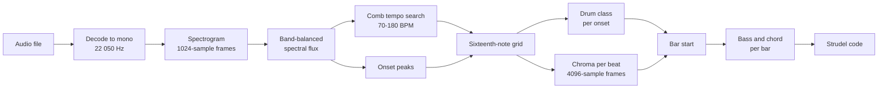

# Strudel Editor: Transcribing Audio into a Pattern

How the import tab turns an audio file into drums, bass and chords. Most of the work went into
four places where a reasonable first version gave a confidently wrong answer.

## The pipeline

The browser decodes the file on the main thread, because `decodeAudioData` is not available in a
worker. Decoding through an `OfflineAudioContext` at 22 050 Hz resamples for free, so nothing is
rendered. Everything after that is pure and synchronous and runs in a worker. The unit tests
drive the same code with synthetic signals.

No analysis library is involved. The repo had none, and the maintained options bring far more
than an FFT (fast Fourier transform), a few band sums and 24 chord templates need.

## A pure FFT has to precompute its indexing

AGENTS.md rules out loops and mutation, and the obvious functional FFT is a recursive
Cooley-Tukey split that builds new arrays at every level. It was correct, and it took 8.6 ms for
one 1024-point frame. A 90-second song needs about 3 900 of those, which is half a minute.

The fix keeps the code pure. It is a Stockham transform, where each of the log₂ N stages reads
one array and writes a fresh one. That needs no bit-reversal pass. Where each output reads its
butterfly inputs from depends only on the frame size, so those index tables are built once and
every frame reuses them. One frame now takes about 0.6 ms. Computing the indices inside the
per-element callback cost most of the original 8.6 ms.

## A plain flux sum cannot hear a kick

Spectral flux adds up how much each bin rose since the previous frame. A hi-hat lifts hundreds
of bins above 5 kHz, while a kick lifts the half-dozen below 150 Hz. Summed over all bins, every
kick came out at about a twentieth of a hat and fell under the onset threshold, so a kick-and-hat
loop read as hats alone.

The flux is now averaged within each of the three drum bands before the bands are added, so each
band carries equal weight whatever its width. For the same reason, the drum classifier looks
only at energy the onset adds over the frame before. A bass note still ringing under a hi-hat
otherwise fills the low band, and the hat is filed as a kick.

## Tempo: half, double, and frame aliasing

The tempo is the whole-number BPM whose comb of beats, at its best phase, sits on the most onset
strength on average. Two related tempos tie in different ways:

| Candidate  | Comb teeth on onsets                    | Average strength |
| ---------- | --------------------------------------- | ---------------- |
| True tempo | every tooth                             | full             |
| Half tempo | every tooth, but only every other onset | full — a tie     |
| Double     | every other tooth                       | half             |

A log-normal prior around 120 BPM breaks most ties. It cannot break the half-tempo tie for fast
music: 174 and 87 BPM sit about equally far from 120. Weighting each candidate by the square root
of its tempo tips that tie towards the faster reading, and still leaves double tempo losing,
since half its teeth miss.

One case survived both. At 174 BPM a beat is 14.85 frames long, so successive clicks land at
different points within a frame. Some clicks split their flux across two frames and read as weak.
The 87 BPM comb has a period of 29.7 frames, close to whole, and could pick a phase that landed
only on the cleanly aligned clicks. Reading the comb as the sum of the three frames around each
tooth, instead of a single frame, counts a split click in full.

## Where the bar starts

The tempo gives beats, not bars. The first rule tried was to put the most kicks on the first beat
of the bar. A four-on-the-floor kick lands on every beat, so all four rotations tie and the first
one wins by default. On a test loop the transcription then read every bar one beat late. The
bass changed on the last beat of each bar and the chord name was right only because three beats
of four outvoted the fourth.

Two quieter faults made it worse. Scoring a candidate offset skipped the kicks before it, so
every later offset lost the opening kicks and offset zero always won. And the first frame's flux
was fixed at zero, so a kick at time zero never existed. Each fault alone shifted the bar by a
beat.

The bar start is now picked in two passes. Kicks narrow it to the beat rotations within one
bar-start kick of the best, with positions wrapped so that no offset is penalised for where it
starts. Among those, the harmony decides: the chosen rotation is the one where the chroma changes
most across each bar line. Real music mostly changes chord on the downbeat. That holds for the
four-on-the-floor case, where drums say nothing, and for the kick-on-one-and-three case, where
drums cannot tell beat one from beat three.

## What it does not do

It hears one bass note per onset and one triad per bar. It does not attempt the melody,
seventh chords, swing or tempo changes. Real snares and hats overlap in the mid band in ways a
three-band split only approximates. The output is meant to be edited.
