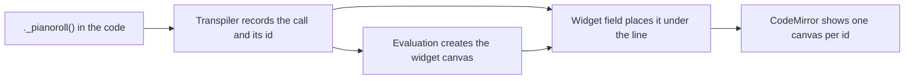

# Strudel Editor: Embedding the strudel.cc Editor

How the Strudel Editor got strudel.cc's inline sliders, pianorolls and scopes, and why it
builds the editor from `@strudel/codemirror`'s parts instead of using the ready-made one.

## The text box could not run strudel.cc code

Strudel's transpiler already understands `slider(0.5)` and `._pianoroll()`. It rewrites a
slider call into `sliderWithID(...)` and records where every widget call sits. But
`sliderWithID`, the slider drawn into the code, and the canvases the widgets paint on all
come from `@strudel/codemirror`. With a plain text box, any pattern copied from strudel.cc
that used a slider failed to evaluate.

## Why not `StrudelMirror`

`@strudel/codemirror` ships `StrudelMirror`, the whole strudel.cc editor in one class. Its
theme handling reaches outside the editor:

| What it does                                        | What it does to this app                                    |
| --------------------------------------------------- | ----------------------------------------------------------- |
| Writes the theme's colours to `:root`, `!important` | Every page gets `--background` and friends while it is open |
| Adds the `dark` class to `<html>` for dark themes   | The whole site switches to its own dark mode                |
| Never undoes either                                 | Leaving the view leaves the site dark                       |

So the editor is assembled from the exported parts: the slider plugin, the mini-notation
highlight, the flash, and the theme's syntax colours. The theme's colour variables are set on
the editor's own element, where the highlight and slider styles still find them. The REPL,
which `StrudelMirror` would also have owned, stays the view's own, so the playback code and its
tests did not change shape.

## Two widgets on a page broke the code view

With two inline widgets, the second line of code vanished from the screen and one widget's
canvas showed in the other's place. The document itself was intact. No error was thrown.

Two things in strudel's widget code meet a newer CodeMirror than strudel.cc runs on:

- Its block widget says it equals every other block widget. CodeMirror reuses the DOM of a
  widget that compares equal, so it moved one canvas into another's place and lost the line
  in between.
- It places each widget at the position where the call ends, mid-line, and current CodeMirror
  draws that by splitting the line, leaving an empty line under every widget.

Pinning `@codemirror/view` back to strudel.cc's version was not an option, because
`@codemirror/lint` already needs the newer one. The view keeps its own small widget field
instead. It still renders strudel's canvases through strudel's widget, but it compares widgets
by their id and places each one after the end of its line.

## The page styles every canvas

Once the widgets rendered, they drew over the first lines of code. `App.vue` sets every
`canvas` to `position: absolute` at the top left at full size, for the 3D views, and the
widget canvases inherited it. A scoped component style cannot reach inside CodeMirror without
`:deep()`, so the editor's own CodeMirror theme sets them back to `position: static`. The
theme's rules are scoped to the editor and outrank a bare `canvas` selector.

The non-inline `.pianoroll()` and `.scope()` draw on the element with the id `test-canvas`,
and create a fixed, full-window one over the whole page when it is missing. Nothing removes
it after the view is gone. The editor's background canvas carries that id instead, so those
visuals draw behind the code and leave with the view.

## Testing a real editor

Strudel core imports `@kabelsalat/web`, whose `main` entry is a browser bundle without named
exports; only its `module` entry is ESM. Vite follows `module`, so the app works. Vitest loads
dependencies through Node, which follows `main`, and fails. Inlining the package moves the
failure to the next one with the same layout, `@tonaljs`, and so on. The editor tests run in
the browser test runner instead, against a real Chromium and Vite's resolver. The unit tests
keep the editor mocked.

One false lead is worth recording. Playwright's `fill()` seemed to drop the last line of
multi-line code. It did not: the line was the one the widget bug hid, after evaluation.
