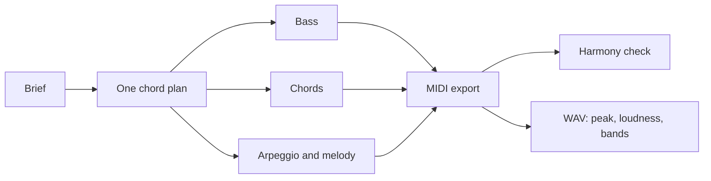

# Recomposing the genre songs

The six genre songs (synthwave, stoner rock, grunge, classical, funk and jazz) passed every check
they had: the hints found them complete, they had sections, and they rendered at a sensible
loudness. Reading them showed they were still wrong in ways none of those checks could see,
because each part had been written against its own idea of the harmony.

## What was wrong

A song in this editor is a set of `$:` blocks, each with its own one-a-bar string. Nothing ties
the bass string to the chord string, so they drift apart silently. Three songs put bass notes under
chords they do not belong to: a C under G and a G under E in the synthwave, an E riff under an F
chord in the grunge, and a funk line transposed up a fifth so that it sat on B under E9. The
synthwave arpeggio stayed on A minor scale degrees while the chords moved to F, G and E. Two more
faults were sound rather than notes: every stoner rock layer ran through a 0.95 room, which blurs a
riff into a wash, and the jazz played straight eighths in a style defined by its swing.

None of this shows in a loudness reading or in the hints, and nobody here can listen. It does show
in the notes themselves.

## The fix: one chord plan, then a check

Each song now declares its chord plan once, one chord a bar, and every pitched part is written
from that list. The arpeggios pick their notes from the chord itself rather than from a scale, so
they follow every change. The harmony is then checked from a MIDI export:
`scripts/strudel-harmony.mjs` lists every note that lands on a beat outside the chord sounding in
its bar.

| Song            | Outside the chord on a beat, before | After | What remains                                      |
| --------------- | ----------------------------------- | ----- | ------------------------------------------------- |
| Neon Drive      | arpeggio 40 of 144                  | 0     | the lead's passing seventh on beat four           |
| Rust and Rain   | bass 20 of 76                       | 0     | thirds over power chords in the hook              |
| Uptown Strut    | brass 32 of 108                     | 3     | fifths the B9 voicing leaves out                  |
| Winter Court    | violin 40 of 71                     | 2     | passing tones on beat four                        |
| Dust and Diesel | bass 20 of 128                      | 0     | the lead's thirds over power chords, which belong |
| Blue Hour       | 7 of 232                            | 5     | chromatic walking approaches and omitted fifths   |

The checker reports rather than judges. A blue note, a third over a power chord or a fifth the
voicing leaves out is right; the point is that every reported note is now one of those.

One trap cost a round of renders. In a one-a-bar string, an item with a weight and no brackets
lasts that many bars: a lone `a4@4` takes four bars, not four beats, and shifts everything after
it. The first versions came out with the violin three bars behind its chords. Every weighted item
is now bracketed.

## The briefs

Each song was written from a brief in the `audio-brief` form, after reading its section of
[the genre guide](../guides/strudel-genres.md).

| Song            | Tempo and key       | Form                                                          | Must not                                              |
| --------------- | ------------------- | ------------------------------------------------------------- | ----------------------------------------------------- |
| Neon Drive      | 100, A minor        | intro 8, verse 8, chorus 8, break 4, chorus 8, outro 4        | a scale-run lead; an arpeggio that ignores the chords |
| Dust and Diesel | 80, D minor, drop D | riff 8, verse 8, chorus 8, breakdown 8, chorus 8, outro 8     | triads; a polite crunch; one drum loop for 48 bars    |
| Rust and Rain   | 120, E minor        | quiet verse 8, loud chorus 8, twice, bridge 4, outro 4        | the same level in verse and chorus                    |
| Winter Court    | 80, D minor         | theme 8, turn to F major 8, theme with counter-line 8, coda 8 | a pad with a scale run; a drum kit                    |
| Uptown Strut    | 105, E              | intro 8, vamp 16, chorus 8, break 8, chorus 8                 | root notes on the beat; chords on every beat          |
| Blue Hour       | 136, B flat major   | intro 4, rhythm changes AABA 32, tag 4                        | straight eighths; block chords on every beat          |

The choices that follow from them:

- **Neon Drive** keeps the guide's verse Am F G E and chorus Am F C G. The octave bass follows
  the root of each bar, a chord-tone arpeggio runs under a two-bar lead motif that is sequenced
  down on its repeat, and the delays are dotted eighths at the tempo.
- **Dust and Diesel** plays one riff on bass and guitar, low and fuzzed in the manner of Kyuss's
  desert rock. The guitar sits at the written pitch of the riff, in drop D, with a fifth added,
  doubled by a second distorted guitar sample; nothing is raised an octave. The first version
  played raw saw waves an octave up and used the LinnDrum bank, and it sounded like a chip tune:
  a plain oscillator is thin and aliased, and the LinnDrum was recorded at 8 bits. The bass is now
  a picked bass sample, the lead is an octave lower, and the kit is the default drum samples.
  Distortion raises the level a long way, so the level is set after the effects. The kit changes
  its kick pattern every bar, adds ghost notes in the verses, moves from hi-hat to ride in the
  choruses and fills on the toms or a snare roll at the end of every four-bar phrase. The snare
  sits a little behind the beat, and the breakdown halves the drums under a held power chord.
- **Rust and Rain** sets a clean arpeggiated guitar and a light kit against an overdriven chorus
  with crashes and an open hat, and the bass gets louder with it. The hook repeats with a changed
  last bar.
- **Winter Court** moves through Dm, Gm and A7 with a real C sharp over the dominant, turns to F
  major in the second section, brings the theme back with a viola counter-line, and ends on a D
  major chord. Timpani mark the four cadences.
- **Uptown Strut** gives the lead to a slap bass that outlines E9, A9 and B9 with octave jumps and
  a slide into each chord, answered by brass in the chorus, and ends on one stab.
- **Blue Hour** uses rhythm changes, two chords a bar, a bass that walks in quarters with
  chromatic approaches, comping on beat two and the and of three, and swung eighths everywhere
  but the bass.

## Measured, not heard

| Song            | Loudness   | True peak |
| --------------- | ---------- | --------- |
| Neon Drive      | -19.5 LUFS | -1.9 dBTP |
| Dust and Diesel | -19.0 LUFS | -3.6 dBTP |
| Rust and Rain   | -19.2 LUFS | -1.0 dBTP |
| Winter Court    | -17.4 LUFS | -5.7 dBTP |
| Uptown Strut    | -19.6 LUFS | -2.8 dBTP |
| Blue Hour       | -17.2 LUFS | -3.1 dBTP |

The spectrograms caught one more fault. The funk break first dropped only the chords, which the
drums covered, so the song read as one block from start to end. The break now thins to kick,
snare and bass, with two bars of bass alone before the last chorus.

Two songs needed their levels lowered after a first render: the synthwave and the grunge both
peaked above 0 dBTP, the synthwave on the bars where its bass and kick land together on C.

None of these numbers says the songs are good. They have not been listened to, and the next step
for each is a person hearing it.
