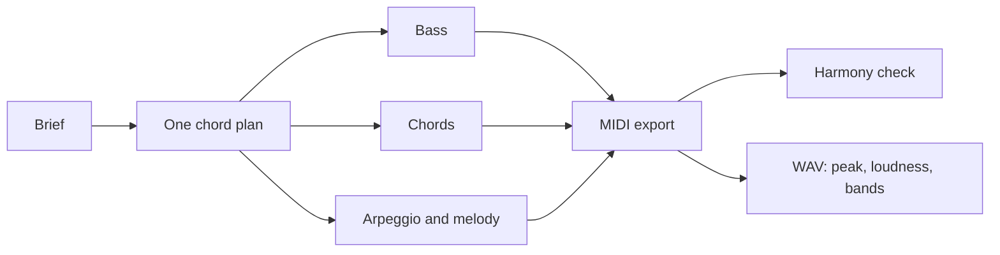

# Recomposing the genre songs

The six genre songs (synthwave, stoner rock, grunge, classical, funk and jazz) passed every check
they had: the hints found them complete, they had sections, and they rendered at a sensible
loudness. Reading them showed they were still wrong in ways none of those checks could see,
because each part had been written against its own idea of the harmony.

## What was wrong

A song in this editor is a set of `$:` blocks, each with its own one-a-bar string. Nothing ties
the bass string to the chord string, so they drift apart silently. Three songs put bass notes under
chords they do not belong to: a C under G and a G under E in the synthwave, an E riff under an F
chord in the grunge, and a funk line transposed up a fifth so that it sat on B under E9. The
synthwave arpeggio stayed on A minor scale degrees while the chords moved to F, G and E. Two more
faults were sound rather than notes: every stoner rock layer ran through a 0.95 room, which blurs a
riff into a wash, and the jazz played straight eighths in a style defined by its swing.

None of this shows in a loudness reading or in the hints, and nobody here can listen. It does show
in the notes themselves.

## The fix: one chord plan, then a check

Each song now declares its chord plan once, one chord a bar, and every pitched part is written
from that list. The arpeggios pick their notes from the chord itself rather than from a scale, so
they follow every change. The harmony is then checked from a MIDI export:
`scripts/strudel-harmony.mjs` lists every note that lands on a beat outside the chord sounding in
its bar.

| Song            | Outside the chord on a beat, before | After | What remains                                      |
| --------------- | ----------------------------------- | ----- | ------------------------------------------------- |
| Neon Drive      | arpeggio 40 of 144                  | 0     | the lead's passing seventh on beat four           |
| Rust and Rain   | bass 20 of 76                       | 0     | thirds over power chords in the hook              |
| Uptown Strut    | brass 32 of 108                     | 3     | fifths the B9 voicing leaves out                  |
| Winter Court    | violin 40 of 71                     | 2     | passing tones on beat four                        |
| Dust and Diesel | bass 20 of 128                      | 0     | the lead's thirds over power chords, which belong |
| Blue Hour       | 7 of 232                            | 5     | chromatic walking approaches and omitted fifths   |

The checker reports rather than judges. A blue note, a third over a power chord or a fifth the
voicing leaves out is right; the point is that every reported note is now one of those.

One trap cost a round of renders. In a one-a-bar string, an item with a weight and no brackets
lasts that many bars: a lone `a4@4` takes four bars, not four beats, and shifts everything after
it. The first versions came out with the violin three bars behind its chords. Every weighted item
is now bracketed.

## Writing a song without repeating itself

The first versions spelled every bar out: a chord string of forty items, a bass string of forty
items, and runs of `~ ~ ~ ~ ~ ~ ~ ~` for the bars a part sits out. They were long, and a change to
the form meant editing four strings in step. The songs now say each thing once:

| Repetition                                  | Written as                                                         |
| ------------------------------------------- | ------------------------------------------------------------------ |
| a section that lasts several bars           | `arrange([8, verse], [8, chorus])`, with a one-a-bar string inside |
| the same plan for chords, bass and a melody | a small function, `plan(verse, chorus, outro)`, called once each   |
| a chorus that comes back                    | a `const` used twice                                               |
| bars a part sits out, or the same bar twice | `silence`, or `~!8`, `<a!3 b>`                                     |
| a kick that changes every bar               | `cat(k1, k2, k3, k4)` from named one-bar cells                     |
| a fill at the end of every four-bar phrase  | a function of the fill, mapped over the list of fills              |
| the first bars of a section, then a new end | `[7, line], [1, end]`                                              |

The hints tab reads sound names from the song's own `$:` blocks, not from constants, so a drum
layer keeps its sample in the block, as `s("bd").struct(kicks)`, with the rhythm in a constant. A
layer written as `s(kicks)` leaves the block with only a crash cymbal in it, and the hints then
report the drums as off style.

The rewrite was checked against the songs it replaced. Each was exported to MIDI before and after,
and every track matches note for note at the same times: 4 to 5 tracks a song, no note missing
and none added. The six songs went from 21,000 to 14,600 characters. The eight earlier style songs were already
written with `!` and short strings, so they only gained shared constants for masks they repeated and
one drum bank per group, again with every track matching; Tideline, Harbour Steps, Wire Fence and
Lift Off had nothing left to share. Every one of the first fourteen now names its instruments in a
comment under its style line.

## The briefs

Each song was written from a brief in the `audio-brief` form, after reading its section of
[the genre guide](../guides/strudel-genres.md).

| Song            | Tempo and key       | Form                                                          | Must not                                              |
| --------------- | ------------------- | ------------------------------------------------------------- | ----------------------------------------------------- |
| Neon Drive      | 128, A minor        | intro 4, verse 8, chorus 8, breakdown 4, chorus 8, outro 4    | a scale-run lead; an arpeggio that ignores the chords |
| Dust and Diesel | 80, D minor, drop D | riff 8, verse 8, chorus 8, breakdown 8, chorus 8, outro 8     | triads; a polite crunch; one drum loop for 48 bars    |
| Rust and Rain   | 120, E minor        | quiet verse 8, loud chorus 8, twice, bridge 4, outro 4        | the same level in verse and chorus                    |
| Winter Court    | 80, D minor         | theme 8, turn to F major 8, theme with counter-line 8, coda 8 | a pad with a scale run; a drum kit                    |
| Uptown Strut    | 105, E              | intro 8, vamp 8, chorus 8, break 8, chorus 8 and a last hit   | root notes on the beat; chords on every beat          |
| Blue Hour       | 136, B flat major   | intro 4, rhythm changes AABA 32, tag 4                        | straight eighths; block chords on every beat          |

The choices that follow from them:

- **Neon Drive** keeps the guide's verse Am F G E and chorus Am F C G. The octave bass follows
  the root of each bar, a chord-tone arpeggio runs under a two-bar lead motif that is sequenced
  down on its repeat, and the delays are dotted eighths at the tempo. It was rewritten at 128 BPM
  in four sections of drums, bass, arpeggio, lead and a string pad, each its own `arrange` line:
  a sparse syncopated bass in the intro and outro against driving sixteenths in the verse and chorus,
  a square lead an octave up that arrives only in the choruses, and a pad that returns in the breakdown.
- **Dust and Diesel** plays one riff on bass and guitar, low and fuzzed in the manner of Kyuss's
  desert rock. The guitar sits at the written pitch of the riff, in drop D, with a fifth added,
  doubled by a second distorted guitar sample; nothing is raised an octave. The first version
  played raw saw waves an octave up and used the LinnDrum bank, and it sounded like a chip tune:
  a plain oscillator is thin and aliased, and the LinnDrum was recorded at 8 bits. The bass is now
  a picked bass sample, the lead is an octave lower, and the kit is the default drum samples.
  Distortion raises the level a long way, so the level is set after the effects. The kit changes
  its kick pattern every bar, adds ghost notes in the verses, moves from hi-hat to ride in the
  choruses and fills on the toms or a snare roll at the end of every four-bar phrase. The snare
  sits a little behind the beat, and the breakdown halves the drums under a held power chord.
- **Rust and Rain** sets a clean arpeggiated guitar and a light kit against an overdriven chorus
  with crashes and an open hat, and the bass gets louder with it. The hook repeats with a changed
  last bar.
- **Winter Court** moves through Dm, Gm and A7 with a real C sharp over the dominant, turns to F
  major in the second section, brings the theme back with a viola counter-line, and ends on a D
  major chord. Timpani mark the four cadences.
- **Uptown Strut** gives the lead to a slap bass that outlines E9, A9 and B9 with octave jumps and
  a slide into each chord, answered by brass in the chorus, and ends on one stab. The rewrite is
  thirty-two bars: a short intro on the E9 vamp, a chorus, a break, a second chorus and a last hit.
- **Blue Hour** uses rhythm changes, two chords a bar, a bass that walks in quarters with
  chromatic approaches, comping on beat two and the and of three, and swung eighths everywhere
  but the bass.

## Measured, not heard

| Song            | Loudness   | True peak |
| --------------- | ---------- | --------- |
| Neon Drive      | -19.5 LUFS | -2.3 dBTP |
| Dust and Diesel | -18.9 LUFS | -3.9 dBTP |
| Rust and Rain   | -19.5 LUFS | -1.3 dBTP |
| Winter Court    | -17.3 LUFS | -5.3 dBTP |
| Uptown Strut    | -19.6 LUFS | -2.8 dBTP |
| Blue Hour       | -17.2 LUFS | -3.1 dBTP |

The spectrograms caught one more fault. The funk break first dropped only the chords, which the
drums covered, so the song read as one block from start to end. The break now thins to kick,
snare and bass, with two bars of bass alone before the last chorus.

Two songs needed their levels lowered after a first render: the synthwave and the grunge both
peaked above 0 dBTP, the synthwave on the bars where its bass and kick land together on C.

None of these numbers says the songs are good. They have not been listened to, and the next step
for each is a person hearing it.

## Three songs for the instrument presets

Three more songs play the instrument presets of the Instruments tab, so they sound the same for everyone: Sun Bleached (stoner rock), Paper Skies (grunge) and Hollow Chambers (death metal). Death metal had no style, so it gained one and a section in [the genre guide](../guides/strudel-genres.md). The tempo is the first thing checked, since a genre at the wrong speed reads as another genre.

| Song            | Style       | Written BPM | BPM from the MIDI file | Form                                                                    |
| --------------- | ----------- | ----------- | ---------------------- | ----------------------------------------------------------------------- |
| Sun Bleached    | stoner rock | 96          | 96.00                  | intro 4, verse 8, chorus 8, half time break 4, chorus 8, outro 4        |
| Paper Skies     | grunge      | 112         | 112.00                 | quiet verse 8, loud chorus 8, twice, bridge 4, outro 4                  |
| Hollow Chambers | death metal | 200         | 200.00                 | intro 4, blast 8, half time groove 8, tremolo 8, final blast 8, outro 4 |

The measured value is the shortest gap between note onsets on the busiest pitched track, multiplied back to beats (eighths in the first two, tremolo sixteenths in the third), and the file's own tempo agrees. Drums are not in the MIDI file, since a drum preset sound has no pitch, so the guitar and bass carry the check.

- **Sun Bleached** is a different feel from the 72 BPM riff and the 80 BPM Dust and Diesel: faster, in A, with the guitar riff, the bass and the kick each on its own rhythm. The chorus adds a ride from the TR-909 bank, claps and a soft, low `doomorgan_note` organ, and the break drops to half time.
- **Paper Skies** is a clean `jangle` arpeggio over a `campfire` acoustic strum and a light kick against a `seattle` fuzz chorus with pumping eighth bass and a pentatonic hook. The bridge holds an organ.
- **Hollow Chambers** tremolo picks sixteenths at 200 BPM in drop A, with a semitone and a tritone around the root, a half time groove of palm muted gallops, and a blast beat in two forms. Every kick and snare is clipped to its event: a sixteenth is 75 ms, and a 0.6 s kick sample would otherwise run on through the next hits.

| Song            | Loudness   | True peak |
| --------------- | ---------- | --------- |
| Sun Bleached    | -15.0 LUFS | -2.3 dBTP |
| Paper Skies     | -14.8 LUFS | -1.7 dBTP |
| Hollow Chambers | -12.3 LUFS | -1.6 dBTP |

The first mixes peaked at or above 0 dBTP in the choruses, where fuzz guitar, bass and drums land together, so every gain was lowered rather than the file normalised. The harmony check reports only fifths, flat sevenths and passing fourths of the lead over power chords, which belong: the chord track holds only roots, because the fifth and octave are inside the sample. None of these numbers says the songs are good. They have not been listened to.

## Two more songs and a refresh

Acid Doom (psytrance doom) and Late Fusion (jazz funk) joined the list, and Neon Drive, Uptown Strut and Sun Bleached were rewritten. The loudness figures above were measured on the earlier versions of those three and have not been taken again.

| Song        | Style          | BPM | Form                                              |
| ----------- | -------------- | --- | ------------------------------------------------- |
| Acid Doom   | psytrance doom | 145 | intro 8, groove 16, breakdown 8, drop 16, outro 4 |
| Late Fusion | jazz funk      | 100 | intro 4, three 8 bar choruses, one final hit bar  |

- **Acid Doom** plays a rolling psytrance bass of three sixteenths between each kick against a half time square fuzz riff on the same roots. A sawtooth acid arpeggio opens the filter in the drop, and a distorted clean guitar wails slowly over the breakdown and the drop. Every part derives from one chord a bar, `Em F Em Bb`.
- **Late Fusion** stacks a slap bass with root, octave pop and ghost note layers over a LinnDrum groove with a displaced kick and ghosted snares. Electric piano stabs change rhythm between choruses, a tenor sax states a motif and then solos on the chord plan, and a clean guitar solo and a string pad come in for the return of the head. It is a funk groove on jazz chords, so it sits beside Blue Hour rather than replacing it.
