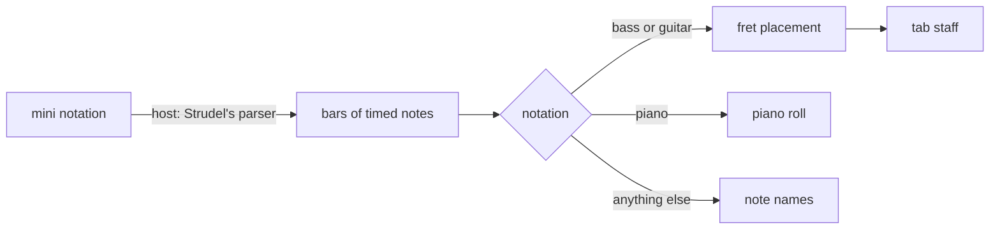
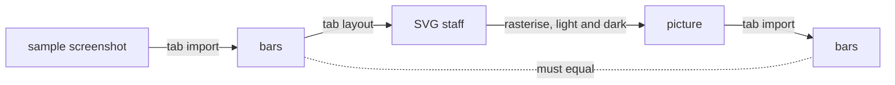

# Strudel Flow: Drawing a Notes Node as a Tab

The flow editor's Notes node used to show its pattern only as mini notation, a line such as
`<[a2@6 a2@3 e3@6 ...] [f2@2 f2 ...]>`. It is exact, and nobody can read it as music. The tab
import could already turn a screenshot of a bass tab into exactly such a line, so the editor took
a tab in but could not show one back. The node now draws its notes the way a player of that
instrument reads them: a guitar or bass tab, a piano roll, or plain note names for anything else.

## Where the notes come from

A mini notation line has to become notes with a start and a length before anything can be
drawn. Writing a second parser for `<>`, `@`, `!`, `*`, rests and chords would have meant a
second set of rules that drift from Strudel's own. Strudel already answers the question: parse
the line, ask the pattern for its events one cycle at a time, and each event carries its note,
its start and its end as exact fractions of a cycle. One cycle is one bar, and a cycle's length
in beats is the patch's own beats per cycle.

The flow package does not load Strudel; the host does. So the host hands the editor a reader,
the same way it hands over its sample library for the pickers, and the package stays free of
the dependency. Without a reader a Notes node simply shows its text, as before.

A pattern has no declared length, so the reader asks for a fixed number of cycles and keeps the
shortest run of bars that the rest repeat. `<a b c>` comes back as three bars, `a b` as one.
Notes that start and end together are one chord.

## Picking the notation

Auto looks at the sound the notes play. That is the sound of the first Voice node the node's
cables reach, or failing that an `.s()` call kept on the node itself. A table in the package
config matches a word in the sound's name: bass gives a bass tab, guitar a guitar tab, and piano,
keys, organ and their relatives a piano roll. Everything else, a sawtooth or a sample bank, falls
back to note names, which suit any sound. A picker on the node overrides Auto, and the choice is
per node so a bass line and a guitar part in one patch each get their own staff. The picker's
Auto entry names what it chose, so it never looks like a guess.

Rebuilding the graph from code keeps a picked notation on the node it reuses, since the code says
nothing about how a node is drawn. A patch saved before the field existed reads it as Auto.

## Choosing a string and a fret

A note on a stringed instrument can usually be played in several places. An A on a bass is the
second fret of the G string, the seventh of the D string, the twelfth of the A string. The tab
has to pick one, and the pick decides whether the line is playable.

The rule is the one a player follows without thinking: move the hand as little as possible.
Each chord is placed on the strings that keep its frets closest to where the hand already is,
within the first 24 frets, and a chord is kept within a span of four frets where any such
placement exists. Open strings need no finger, so they never count towards that span. Every
string carries one note at a time; when a chord has more notes than strings, or two notes only
one string reaches, the highest is dropped first. A note below the lowest open string or beyond
the 24th fret is left off the tab rather than drawn somewhere wrong.

| Situation                         | Choice                                               |
| --------------------------------- | ---------------------------------------------------- |
| a single note                     | the string with the smallest move from the last note |
| a chord                           | distinct strings, within four frets, smallest move   |
| no placement within four frets    | the smallest move without the span limit             |
| more notes than strings will take | drop the highest note and try again                  |
| out of range                      | left off the tab                                     |

The open string tunings used to live in the import's config. Import and display now both need
them, so they moved into the flow package's config. The import reads the tab in a Web Worker,
and the worker cannot import the package: the build does not tree shake, so the package's entry
would drag the whole node editor, its stylesheets included, into the worker. The editor's main
thread passes the tunings in with each request instead.

## Drawing what the import reads

The tab is drawn in exactly the vocabulary the import reads, which turns the two into a test of
each other. Fret numbers sit on the string lines; a stem under the staff marks each note; one
beam halves its length, two quarter it, three eighth it; a bracket with a 3 marks a triplet; and
a stem with no number above it is a tie, the previous note still ringing.

A length that no single stem can carry is split: first at every whole beat, so no stem crosses
the beat, then into the fewest standard lengths, tied together. A note of a beat and a half
becomes a quarter tied to an eighth. A triplet length becomes one stem under a bracket. Stems
inside one beat that both carry a beam are joined at that level, and a stem alone at its level
gets a flag pointing into its group.

A few details exist only because the reader would otherwise misread the picture:

- Staff lines and ties are faint, numbers and rhythm marks bright. The reader finds numbers by
  their brightness, and a bright line would read as one endless number.
- The string line breaks around each number instead of running behind it, which is how printed
  tabs look and keeps the digit's shape clean.
- The staff has clear line at both ends. The reader finds where a staff starts by a long
  unbroken stretch of line, so a number right at the edge would move the edge.
- Every bar is at least a minimum width, or a short bar's line would look like a stray stroke.
- Numbers are set in Arial, the typeface one of the reader's digit templates was sampled from.

A rest gets a stem's room and a small faint block in the middle of the staff, including the
rest that closes a bar which stops early. The reader has no rest symbol, and the middle of the
staff is a place it never looks: too faint to be a number, too short to be a line, and above the
rhythm row. A rest in the middle of a bar still does not survive the round trip, since the reader
cannot see it, while one at the end does, because the reader fills a short bar.

## The round trip test

The strongest check of a renderer is a reader that never saw its code. The test imports the
sample bass screenshot, draws its twenty bars as a tab, rasterises that drawing in both themes,
and reads the picture back with the import. Every note and every length must come back
unchanged, and no fret number may be unreadable. A guitar case does the same with chords on six
strings.

The test found nothing to fix in the reader, which is the point: the drawing speaks the reader's
language because both follow the same geometry, measured in multiples of the gap between two
staff lines.

## Piano roll and note names

The piano roll is the first answer to the piano case because Strudel already speaks it: one row
per semitone, black key rows shaded, a C labelled per octave, notes as blocks along the bars. A
five line staff is its own follow up; it needs clefs, ledger lines and accidentals, none of
which a roll does.

Note names list each bar's notes with their lengths as a musician writes them, 1/2 or 1/6
rather than 0.1667, chords joined with commas as in mini notation.

## Two traps along the way

Strudel's core module would not load in the unit tests: Node resolved one of its dependencies to
a build without the export it imports. Letting the test runner bundle Strudel's core and mini
notation packages itself, as it already did for the physics engine, resolves it the same way the
browser does.

Vue Flow tells a node component its own id through injection, but does not export the key, so a
test cannot provide it. Its composable for reading the id can be replaced in the test instead.
