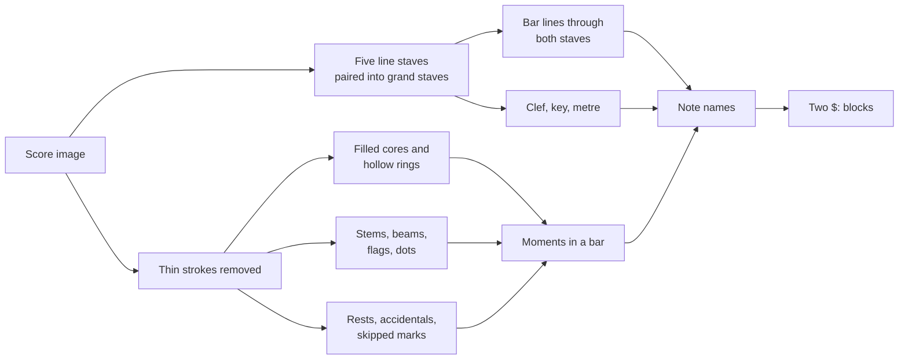

# Strudel Editor: Reading a Piano Score Without a Model

How the import tab turns a picture of piano music in standard notation into a pattern for both
hands, with the same plain image processing as the
[tab screenshot reader](./strudel-tab-image-import.md). Optical music recognition is a research
field of its own, and most of it now uses trained models. The question here was how far a clean
digital engraving can be read with geometry alone, and the honest answer is: the first bars of a
real arrangement note for note, every bar of the left hand, and most of the right hand.

## Same foundation, harder page

The tab reader's two decisions carry over unchanged. Pixels become their distance from the page
colour, and every length is a multiple of the gap between two staff lines. What changes is the
page. A tab names each note with a printed number and keeps the rhythm in its own row; a score
encodes pitch as a height and rhythm as the shape of the note itself, its stem, beams, flags and
dots, all drawn on top of the staff lines and of each other.

## Take the lines out first

Almost every symbol touches a staff line, a ledger line, a tie or a slur, and all of those are
thin horizontal strokes. So the page is read twice: once with every bright pixel, and once with
any pixel whose vertical run of ink is no thicker than about a fifth of a gap removed. That
removes lines, ledger lines, ties and slurs in one pass, and keeps beams, note heads and the
heavy bars of a sharp, because their runs are thicker. A sign that falls apart where a thin
stroke joined it, an eighth rest or a bold common time sign, is put back together by joining
pieces that come within a third of a gap of each other.

The structure of the page comes first, and comes easily: staves are the tab reader's line groups
with five lines instead of four or six, taken in pairs. A piano bar line runs unbroken from the
top of the treble staff to the bottom of the bass staff, which no stem or clef does, so bars
need no further test.

## What makes a note head

A filled head is the only mark that is both wide and tall at once. A beam is wide and thin, a
stem or the upright of a sharp is tall and narrow. A pixel whose horizontal run reaches most of a
gap and whose vertical run reaches three quarters of one is inside a head, and a small cluster of
such pixels is one head. That one rule found every filled head on the sample page.

A hollow head is found by its hole: background closed in on all four sides within half a gap.
Many other things enclose a little background, so the hole has to pass more tests. The ring
around it must be about a head wide, and ink that runs on for a whole gap is a beam or a line,
not a ring. A sharp or a natural encloses its middle between two long upright strokes, which a
head never has. And a gap closed in between a filled head and its dot, or a grace note and its
main note, is not a head, so a hole too close to a filled head is dropped. Each of these rules
was added because the sample produced exactly that false head.

Pitch is then a matter of counting half gaps from the bottom line, which the clef names, and
applying the key and any accidental printed in front of a head earlier in the same bar.

## Rhythm is in the shape, and in the arithmetic

A stem is any upright stroke at least two and a half gaps long; it carries the heads it touches,
and a head counts only if the stem reaches well past it. Its free end, the one away from the
heads, carries the beams or flags, counted as separate bands of ink to the side. A neighbour's
accidental also sits to the side of a stem, so ink that belongs to a long upright stroke is not
counted as a beam. Hollow means half, a hollow head without a stem is a whole note, and a small
speck just right of a head is a dot.

Rests have no stem and sit near the middle line. Height alone separates them: a solid block for a
whole or half rest, a short hook for an eighth, a tall zigzag for a quarter. A block must touch
the line a whole rest hangs from or a half rest sits on, because a fragment of a tie that the line
removal left behind is also a small solid block.

Two voices on one staff break the simple sum of lengths. Moments are therefore timed as a sweep:
each moment lasts until the first note or rest still sounding ends, whichever voice it belongs to.
A dotted quarter in one voice under eighths in the other is then counted once, not twice.

As in the tab reader, the strongest check is that every bar must add up to the metre. It caught
each wrong rule above. A first bar that comes up short in both hands is a pickup, so its rest goes
in front of the notes rather than after them.

## Where it stands on the sample

The sample is a published arrangement of a slow piece in A major: three sharps, common time, a
tempo marker of 65, two staves of mixed eighths and sixteenths, chords, ties and grace notes.

| Read                                  | Result                                                   |
| ------------------------------------- | -------------------------------------------------------- |
| Grand staves, bars, clefs, key, metre | all correct                                              |
| Tempo marker                          | 65, after widening the band and the glyph sizes it reads |
| First six bars, both hands            | note for note, with every length right                   |
| Left hand, all fifteen bars           | every bar adds up to four beats                          |
| Right hand                            | ten of fifteen bars add up                               |

The right hand bars that fail are the ones with two voices whose rests are moved off the middle
line, or a grace note whose small head and slash look like a rest. They are reported by bar number
rather than hidden, and the code still plays.

## What it does not do

| Missing                             | Why                                                                        |
| ----------------------------------- | -------------------------------------------------------------------------- |
| Ties                                | Removed with the thin strokes, so a tied note is struck again.             |
| Grace notes, ornaments, trills      | Skipped and named by bar; a small head is too close to a rest to guess.    |
| Dynamics, pedal marks, words        | Skipped without a mention, since they sit outside the staves.              |
| Triplets and other tuplets          | Not in the sample, so not attempted.                                       |
| Clef, key or metre changes part way | Only the start of each staff is read, and the metre only on the first one. |
| Sixteenth and shorter rests         | Read as quarter rests by height; the bar check then warns.                 |
| Photos, scans, handwriting          | Every rule relies on straight lines and an even line gap.                  |

A different engraving face will need its thresholds checked, the same way the tab reader needed
a template set per typeface. The drawn grand staff in the tests, at a larger zoom than the sample,
is the guard against tuning everything to one page.
