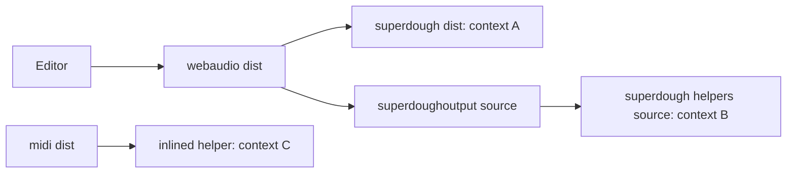

# Strudel's Published Builds and Their Audio Clocks

The WAV export and the MIDI output both looked finished and both did nothing useful. The export
downloaded a file of the right length with every reverb and delay missing. The MIDI snippets
evaluated without an error and sent no notes. Neither failure came from this repo's code: both came
from how Strudel's packages are published to npm.

## One engine, several singletons

Strudel's audio engine, superdough, keeps the audio context in a module-level variable, and every
node it creates asks that variable for its context. Inside the Strudel monorepo every package
imports the same source files, so there is exactly one such variable.

The npm packages are not built that way. Each one ships a bundled `dist` file, and some of them
also reach into another package's source files:

| Package             | What it imports                                                                               | What that creates                                                             |
| ------------------- | --------------------------------------------------------------------------------------------- | ----------------------------------------------------------------------------- |
| `@strudel/webaudio` | superdough's bundled `dist`, plus its source `superdoughoutput.mjs` for offline rendering     | a second copy of the audio context variable, only seen by the output graph    |
| `@strudel/midi`     | a monorepo-relative path, `../superdough/helpers.mjs`, which does not exist in `node_modules` | its `dist` inlines a private helper with its own audio context, never resumed |

Nothing fails when a module loads. The failures only appear when two of those contexts meet in one
audio graph, or when a clock that never started is asked to schedule something.

## Why the export lost its effects

`renderPatternAudio` swaps the context A singleton for an offline context, then builds its output
graph with the controller class from the source file. That controller's sends ask context B for
their gain nodes, and context B is still the live, real-time context. Every `.room()` or `.delay()`
send then tries to connect an offline node to a live one. The browser refuses each one, superdough
logs the error and moves on, and the dry signal still renders. The WAV has the right length and
plays, so nothing looks broken until someone listens for the reverb. The same function also closes
the live context, so playback was dead after an export too.

The editor now renders through its own short path instead. It swaps context A for an offline
context, clears the controller so the bundled one rebuilds itself on that context, plays every hap
through superdough in onset order, and puts the live context and controller back afterwards. Only
context A is ever involved, so every send stays inside the offline graph, and the live context is
never closed.

## Why `.midi()` sent nothing

`@strudel/midi` times each note by asking superdough to fire a callback at a target time on the
audio clock. Its published build carries a private copy of that helper, and the copy creates its
own audio context the first time it is called. That context is created outside a user gesture, so
the browser leaves it suspended. Its clock stays at zero, and a note scheduled for second 120 of
the real clock never arrives.

The editor imports `@strudel/midi`'s source entry instead of its `dist`. A Vite alias points the
monorepo-relative import at a local stand-in that schedules on the shared context. The package is
kept out of Vite's dependency pre-bundling, because the pre-bundler resolves relative imports inside
a package before any alias can apply, and the dev server then fails to start.

## How to spot this class of bug

- A Strudel feature that works on strudel.cc and fails here is a packaging suspect first: strudel.cc
  runs from the monorepo, where none of these splits exist.
- Count the copies. Searching the built chunks for the audio context constructor shows one per
  singleton; more than one means two parts of the engine can disagree about the clock.
- Listen to an export rather than checking its size. A render that drops its effects still has
  exactly the right number of samples.
