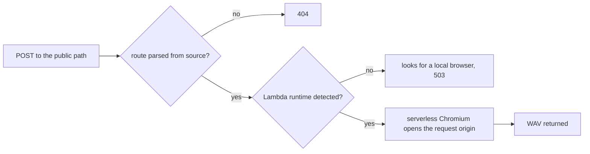

# The Strudel Render API Answered 404 and Then 503

The render function passed every unit test and deployed without a build error, yet
`POST /api/strudel/render` answered 404 on the deploy preview and on production. Fixing that exposed
a second failure behind it. Both came from the gap between what Netlify does at build time and what
it gives a function at run time.

## A route Netlify could not read

The function names its own route and rate limit in an inline config object. Netlify does not run
the code to read that object: it parses the source. A value that comes from an import, such as a
shared constant, is invisible to the parser, so the function was registered with no route at all.
It was still reachable at its internal `/.netlify/functions/` address, which is what made the
failure confusing: the function existed and answered 405 to a GET, but the public path did not.

The route and the rate limit are now literals in the function file. A unit test reads that file
and fails when they stop being literals, because nothing else in the repo notices.

## A build-time variable read at run time

With the route working, the function answered 503. The launch code chose between a local Playwright
browser and the serverless Chromium by reading the build context variable, and it found the editor to
render by reading the site URL variable. Both exist while Netlify builds the site and neither exists
inside a deployed function, which runs on AWS Lambda. The function therefore looked for a local
browser that is not installed and aimed at localhost.

The runtime now tells itself apart by the variable Lambda sets, and the editor is opened on the
origin the request arrived on, so a preview deploy renders with its own editor build.

## Checking it

Calling the preview with a one cycle pattern returned a 48 kHz stereo WAV two seconds long, which
`ffprobe` read without complaint. The render took about 18 seconds, inside the function's 30 second
limit but not by a wide margin on a cold start.
