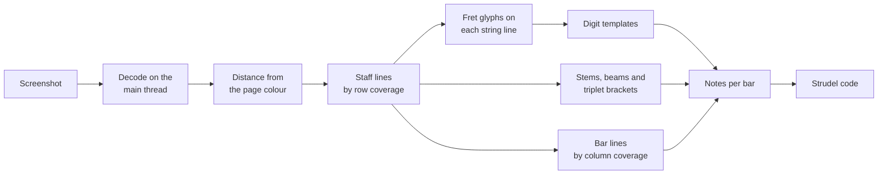

# Strudel Editor: Reading a Tab Screenshot Without a Model

How the import tab turns a picture of a bass or guitar tab into a pattern, using only image
processing. The question that started it was whether a screenshot could become a song with no AI
in the loop. For a clean digital rendering it can, because everything on the page is drawn from a
handful of straight lines and one typeface.

## What makes a tab easy to read

A tab is a diagram, not a photograph. Four or six long horizontal lines are the strings, short
vertical strokes are the bar lines, and numbers sit on the lines to name the fret. Under the staff
a row of stems and beams carries the rhythm. Every one of those has a fixed geometry, so each
can be found by projecting ink onto a row or a column and looking for runs. Nothing needs
learning, and nothing is guessed from context.

## Measure everything in staff gaps

A screenshot arrives at any zoom, on a dark or a light page. Two decisions remove both problems.
Pixels are turned into their distance from the page colour, taken as the median luminance, so
light ink on dark and dark ink on light look the same. Then every length the detectors use is a
multiple of the gap between two staff lines, measured from the staff itself. A digit is about
four fifths of a gap tall, a stem starts a gap under the bottom line, a bar is at least four gaps
wide. The same thresholds work on a thumbnail and on a retina capture.

Two ink levels matter. Staff lines and bar lines are faint, close to a third of full contrast, and
digits, beams and stems are bright. Digits are found in the bright layer only, so a line running
behind a digit never glues itself to it.

## The rhythm row is the clock

The horizontal position of a note says nothing reliable about its length, because tab renderers
space notes for legibility rather than for time. The row of stems under the staff is what carries
the duration. Each stem sits in the same column as the note it belongs to, and the number of
beams or flags on it says how short it is: none for a quarter note, then an eighth, a sixteenth.
A bracket with a number in the middle marks a triplet, which takes two thirds of the usual length.

A stem with no fret number above it is the end of a tie, so the previous note rings on rather
than a new one starting. That rule replaced a plan to detect the tie arc itself, which was harder
and said less.

The strongest check available is arithmetic. Every bar of the sample adds up to exactly four
beats once ties and triplets are counted. A misread beam or a missed stem breaks that sum, so the
test for it catches rhythm errors that no hand transcription of the expected notes would.

## Digits are the weak point

Reading digits at eleven pixels tall is where the first versions failed, in three separate ways.

| Symptom                               | Cause                                                                       | Fix                                                         |
| ------------------------------------- | --------------------------------------------------------------------------- | ----------------------------------------------------------- |
| A 1 read as 9 or 4                    | The flag on a 1 pulls its box off centre, and the box was stretched to fill | Size cells by the glyph's height, and try small side shifts |
| An 8 read as 6                        | Cells that overlapped blurred thin strokes into solid blocks                | Weight each pixel by how much of it a cell really covers    |
| A 6 read as 0 in a different typeface | Hand drawn templates for digits the sample never printed                    | Sample templates from real fonts, one set per typeface      |

The lesson is that a template is only as good as the font it came from. The sample uses one tab
site's typeface and never prints a 2, a 4 or a 6, so those were first drawn by hand and were
wrong. Sampling the browser's own sans serif face in two weights fixed them, and a screenshot in a
different face now only needs another set added as data.

Anything that is not a digit is dropped rather than guessed. A slide or vibrato mark after a fret
is removed, and an unreadable fret is reported as a warning and skipped, so the pattern is never
silently wrong.

## The tempo is a number after an equals sign

The tempo marker is small, dim text in a layout that differs between sites, so no site specific
position can be assumed. What stays the same is its shape: a note symbol, an equals sign, then
digits. The reader scans the band of labels above the first staff, finds a short wide mark made of
exactly two separate bars, and reads the digits right after it with the same templates as the
fret numbers. Digits are normalised by their own strongest pixel, so dim text reads as well as
bright, but the ink level used to find them has to be lower than for fret numbers. A result
outside 30 to 300 beats per minute is treated as a misread and ignored.

## Strokes that look like bar lines

Two things in the sample drew a vertical stroke the full height of the staff without being a bar
line: the large time signature at the start, and a playback cursor outlining one note. Both were
caught by one rule, since neither encloses a plausible bar. A stroke closer than four gaps to the
previous edge is ignored. A double bar line counts once.

## What it does not do

| Missing                                 | Why                                                                                |
| --------------------------------------- | ---------------------------------------------------------------------------------- |
| A tempo given in words                  | Only the form with an equals sign is read. Otherwise the code starts at 120 BPM.   |
| Time signature                          | Assumed to be 4/4. Reading it needs the large digits at the staff start.           |
| Dotted notes, other tuplets, half notes | None occur in the sample, so none were verified against real data.                 |
| Slides, bends, vibrato, ghost notes     | Read as a note without the effect, or skipped with a warning.                      |
| Photos, scans, handwriting              | The geometry is no longer straight and clean, which every detector here relies on. |
| Standard notation                       | Read separately, see [reading a piano score](./strudel-piano-score-import.md).     |

The shape of the result is the reason this stayed small. It writes its own note pattern with
lengths and ties, so the audio and MIDI import, which keeps one bass note per sixteenth, did not
have to grow a duration field it would use nowhere else.
